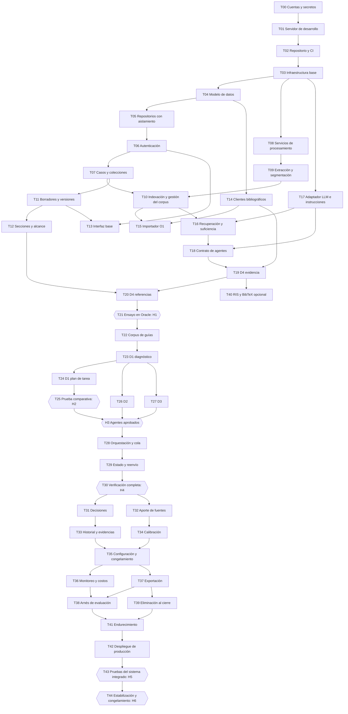

# Hoja de ruta técnica de desarrollo del sistema multiagente con RAG

**Proyecto:** Sistema multiagente con RAG para la asistencia en la producción de artículos científicos empíricos (UTP, Ica).
**Autores del proyecto:** David Roca Cáceres y Ángel Martín Peña García.
**Versión del documento:** 1.0, 5 de noviembre de 2026.
**Naturaleza:** documento maestro de ejecución técnica para Claude Code.

> Este documento **complementa** y **no reemplaza** a la *Fase 2: Hoja de ruta de desarrollo del sistema multiagente con RAG* (documento de planificación con calendario, decisiones e hitos) ni a la *Especificación técnica de la Fase 1*. Aquí no hay fechas, semanas, duraciones ni estimaciones: solo **qué se desarrolla, cómo se implementa y en qué orden técnico**. Si este documento y la especificación de la Fase 1 discrepan en un requisito, manda la especificación y la discrepancia se corrige aquí.

---

## Índice

0. Cómo usar este documento con Claude Code
1. Estado actual del proyecto
2. Línea base de decisiones técnicas
3. Punto de partida y orden técnico
4. Convenciones transversales de ingeniería
5. Mapa de fases
6. Fases detalladas (T00 a T44)
7. Matrices de trazabilidad y control de cobertura
8. Riesgos técnicos que condicionan la ejecución
9. Fuera de alcance
10. Fuentes

---

## 0. Cómo usar este documento con Claude Code

Cada fase (T00 a T44) está escrita para ejecutarse en una o varias sesiones de Claude Code **sin reinterpretar el proyecto**. El procedimiento es siempre el mismo:

1. Abrir Claude Code en el repositorio, en una rama nueva con el nombre de la fase (por ejemplo, `t05-repositorios-aislamiento`).
2. Indicar: *"Ejecuta la fase T05 de `docs/hoja-de-ruta-tecnica/HOJA-DE-RUTA-TECNICA-DESARROLLO.md`. Respeta las convenciones del apartado 4 y el `CLAUDE.md`. Escribe primero las pruebas de la sección Pruebas necesarias, después implementa hasta que pasen."*
3. Claude Code debe leer, además de la fase, los apartados de la especificación de la Fase 1 que la fase cita.
4. Al terminar: ejecutar todas las pruebas, abrir la solicitud de cambio, esperar la integración continua en verde, revisar el comportamiento con los criterios de aceptación e integrar.
5. Marcar la fase como terminada en `docs/hoja-de-ruta-tecnica/ESTADO.md` con la referencia de la solicitud de cambio.

**Reglas que Claude Code no debe romper en ninguna fase:**

- No implementar funcionalidades de fases posteriores "por adelantado".
- No modificar el esquema de datos fuera de una migración de Alembic.
- No escribir consultas a la base que omitan el filtro por caso (apartado 4.5).
- No enviar al proveedor del modelo el .docx completo ni datos que no sean solicitud, alcance y fragmentos (RNF-10).
- No permitir que un modelo de lenguaje escriba referencias bibliográficas (RN-17).
- No usar datos reales de participantes en desarrollo; solo datos ficticios.
- No usar guiones largos en textos visibles para el usuario.

---

## 1. Estado actual del proyecto

No existe todavía código fuente ni repositorio. La sesión en la que se elaboró este documento no tiene una cuenta de GitHub vinculada, de modo que **no fue posible inspeccionar ningún repositorio**; si al ejecutar T02 ya existiera código, la primera tarea de T02 es inventariarlo frente a este documento.

| Ámbito | Estado | Fuente |
| --- | --- | --- |
| Requisitos funcionales RF-01 a RF-27 | Definidos y aprobados (RF-18 a RF-27 aceptados en D-01) | Especificación Fase 1, apartado 8 |
| Requisitos no funcionales RNF-01 a RNF-24 | Definidos y aprobados | Especificación Fase 1, apartado 9 |
| Reglas de negocio RN-01 a RN-24 | Definidas y aprobadas | Especificación Fase 1, apartado 10 |
| Casos de uso CU-01 a CU-16, historias HU-01 a HU-15 | Definidos (versión 2) | Tesis 6.2.3 y documento Modelo de casos de uso |
| Casos de prueba CP-01 a CP-23 y PI-01 a PI-09 | Definidos en la tesis | Tesis 6.2.7.1 |
| Arquitectura lógica, física y comunicación | Definida | Especificación Fase 1, apartados 12 a 14 |
| Contrato y especificación de los agentes | Definidos | Especificación Fase 1, apartado 6 |
| Diseño RAG y del corpus | Definido | Especificación Fase 1, apartado 18 |
| Modelo de datos | Definido a nivel de entidad (15 tablas) | Especificación Fase 1, 12.4 y 18.2 |
| Diccionario de datos por columna | **Falta** | Se produce en T04 |
| Contrato de la API (rutas) | **Falta** | Se produce progresivamente desde T03 |
| Instrucciones (prompts) de los agentes | **Faltan** | Se redactan en T19 a T27 |
| Borradores de prueba, corpus provisional, corpus de guías | **Faltan** (carril de insumos) | Fase 2, apartados 10 y 12.3 |
| Código fuente | **No existe** | Se inicia en T02 |

**Lo que necesita fortalecerse antes o durante la ejecución:**

- La lista de normas de citación de D-12 (propuesta: IEEE por defecto y APA 7) debe confirmarse antes de T20.
- El límite de tokens por minuto del plan gratuito de Groq obliga a un presupuesto de contexto en desarrollo (apartado 8, riesgo R-01).
- Producción en Oracle requiere un **nombre de dominio** para HTTPS (T21); no estaba identificado en las fases anteriores.
- Las métricas de la versión estable deben calcularse con el modelo y la configuración de producción, no con los modelos gratuitos de desarrollo (T38).

---

## 2. Línea base de decisiones técnicas

| Ámbito | Decisión vigente | Origen |
| --- | --- | --- |
| Lenguaje y API | Python 3.12, FastAPI, Pydantic 2, SQLAlchemy 2 con psycopg 3, Alembic | D-01 |
| Interfaz | React, TypeScript, Vite y una biblioteca de componentes accesible (se elige en T13) | D-01 |
| Orquestación | LangGraph 1.x con checkpointer en PostgreSQL | D-01 |
| Base de datos | PostgreSQL 16 o superior con pgvector (HNSW) y búsqueda de texto (`tsvector`, configuración `simple`); cola de trabajos en PostgreSQL con `SELECT ... FOR UPDATE SKIP LOCKED` | D-01 |
| Embeddings y reranking | bge-m3 (1 024 dimensiones) y bge-reranker-v2-m3, locales en CPU, servidos por un **servicio de modelos compartido** | D-01 y Fase 2, 13.1 |
| Procesamiento documental | Docling (texto, títulos, páginas), GROBID (metadatos y referencias), python-docx (borradores) | D-01 |
| Servicios bibliográficos | Crossref, negociación de contenido de doi.org, Unpaywall, OpenAlex (con clave) | D-01 |
| Modelo de lenguaje en desarrollo | GroqCloud como principal (modelo candidato: `openai/gpt-oss-120b`, que admite salida estructurada estricta); respaldo DeepSeek (saldo prepagado) y luego Gemini; **solo datos ficticios** | D-06 |
| Modelo de lenguaje en piloto y O2 | Proveedor comercial de pago sin entrenamiento con los datos, elegido en la prueba comparativa (T25) y nombrado en el consentimiento | D-10, pendiente de la fecha del comité |
| Entorno de desarrollo | Instancia ARM de Oracle Always Free en la cuenta de David, compartida por ambos integrantes con usuarios separados | D-03 y Fase 2, 13.1 |
| Producción | Instancia ARM de Oracle Always Free en la cuenta de Ángel; contingencia: servidor de pago si no supera la prueba de carga; **no** se crean cuentas gratuitas adicionales | D-14 y Fase 2, 13.1 |
| Repositorio | Organización de GitHub del proyecto, privado; ramas cortas sobre la principal; integración por solicitud de cambio con integración continua; versiones con etiquetas | D-02 y D-15 |
| Norma de citación | Elegible por caso desde una lista cerrada; IEEE por defecto | D-12 |
| Verificación temprana | Comprobaciones deterministas de esquema e identificadores de cita desde el contrato común (T18) | D-07 |
| Primer módulo | Núcleo de persistencia, acceso y aislamiento por caso | D-05 |
| Ensayo de despliegue | Al cerrar el agente D4, en Oracle de producción | D-08 |
| Corpus de 2027-1 | Importación en el entorno de desarrollo del investigador y traslado a producción por respaldo y restauración | D-09 |
| Valores fijados de la Fase 1 | Sesión de 8 h con 60 min de inactividad y dos sesiones por cuenta; .docx hasta 15 MB; PDF hasta 25 MB y 60 páginas; percentil 95 de 60 s por solicitud y 120 s por verificación de 40 referencias; sin memoria entre solicitudes; fragmentos breves con enlace; PDF faltantes los sube el investigador; trazas en la nube solo en desarrollo | Tabla 48 aceptada |

---

## 3. Punto de partida y orden técnico

**El punto de partida real es la persistencia con aislamiento por caso (T04 a T07), precedida por el entorno y el repositorio (T00 a T03).** No es la interfaz, ni el modelo de lenguaje, ni el RAG, por tres razones verificables en la especificación:

1. **Todo componente lee o escribe en el modelo de datos.** El registro metodológico (RNF-01) y la exportación (RF-17) dependen de que cada solicitud, fragmento, resultado, verificación y decisión tengan su tabla desde el primer uso. Añadir tablas después obliga a migrar datos de prueba y a reescribir servicios.
2. **El aislamiento entre casos se garantiza en la capa de repositorios, no en los agentes** (Especificación 6.1). Si la recuperación o los agentes se construyen antes, cada consulta tendrá que revisarse después.
3. **La lógica de la solución impone una cadena de datos:** sin corpus indexado no hay recuperación; sin recuperación no hay generación con citas cerradas; sin contrato común no hay verificación; sin los cuatro agentes el orquestador no tiene a quién asignar. El orden de las fases sigue esa cadena.

Dentro de esa cadena, el orden respeta los bloques de la tesis (Tabla 20): bloque 1 (corpus, casos, versiones, agente D4), bloque 2 (corpus de guías, D1, D2, D3), bloque 3 (orquestador, verificación completa, registro de interacciones y administración).



**Paralelismo posible (D-04, dos carriles):** T08 a T10 en paralelo con T11 a T13; T14 en paralelo con T09 y T10; T26 en paralelo con T27; T36 en paralelo con T37. El bloque 3 desde T28 es una cadena con poco paralelismo.

---

## 4. Convenciones transversales de ingeniería

Estas convenciones aplican a **todas** las fases. Cada fase solo indica lo que añade.

### 4.1. Estructura del repositorio

```text
sistema-multiagente-rag/
  CLAUDE.md                      convenciones para Claude Code
  README.md                      cómo levantar, probar y desplegar
  docker-compose.yml             servicios de desarrollo
  docker-compose.prod.yml        servicios de producción (T21, T42)
  .env.example                   variables sin valores reales
  .github/workflows/ci.yml       integración continua
  docs/
    especificacion-fase1/        especificación técnica de la Fase 1
    hoja-de-ruta-fase2/          planificación (copia de consulta)
    hoja-de-ruta-tecnica/        este documento y ESTADO.md
    decisiones/                  un archivo por decisión (D-01 a D-15 y nuevas)
    diccionario-de-datos.md      (T04)
    api/                         notas de la API; el contrato vive en OpenAPI
    operacion/                   despliegue, respaldo, restauración (T21, T42)
  backend/
    pyproject.toml
    alembic.ini
    migraciones/
    app/
      main.py                    creación de la aplicación FastAPI
      configuracion/             lectura de variables y validación (T03)
      bd/                        sesión, modelos ORM (T04)
      repositorios/              acceso a datos con filtro por caso (T05)
      seguridad/                 contraseñas, sesiones, dependencias de autorización (T06)
      casos/                     casos, temas, cuentas (T07)
      corpus/                    extracción, segmentación, indexación, gestión (T09, T10, T22)
      borradores/                carga, versiones, secciones (T11, T12)
      bibliografia/              clientes y limitadores (T14), importador (T15), normas de citación (T20)
      rag/                       recuperación, fusión, reranking, suficiencia (T16)
      llm/                       adaptador y proveedores (T17)
      instrucciones/             carga y versionado de instrucciones (T17)
      agentes/                   contrato común (T18), d4 (T19, T20), d1 (T23, T24), d2 (T26), d3 (T27)
      orquestacion/              grafo, cola, trabajador (T28)
      verificacion/              comprobaciones, evaluador, etiquetas (T18, T30)
      registro/                  decisiones, historial (T31, T33)
      administracion/            configuración versionada, exportación, purga, monitoreo (T35 a T39)
      api/                       rutas por módulo
      comun/                     errores, registro de eventos, utilidades
    instrucciones/               archivos de instrucciones versionados por agente
    trabajador.py                proceso de la cola (T28)
    pruebas/
      unitarias/
      integracion/
      contrato/                  respuestas grabadas de servicios externos
      agentes/                   pruebas de comportamiento
      datos/                     casos y documentos ficticios
  servicio_modelos/              servicio compartido de embeddings y reranking (T08)
  frontend/                      aplicación React (T13 en adelante)
  evaluacion/
    conjuntos/                   consultas con evidencia esperada, referencias de prueba
    arnes/                       línea de comandos del arnés (T38)
  datos/                         PDF y borradores de prueba; excluida de Git
```

Las carpetas se crean en la fase que las usa; T02 crea solo el primer nivel.

### 4.2. Estándares de código

- **Python:** tipado completo; Ruff para formato y análisis; mypy en modo estricto para `app/`; funciones de servicio sin acceso directo a la sesión de base fuera de `repositorios/`.
- **TypeScript:** modo estricto; ESLint y Prettier; cliente de la API generado desde el contrato OpenAPI, nunca escrito a mano.
- **Esquemas:** todo dato que cruza una frontera (API, cola, agentes, servicios externos) tiene un modelo Pydantic.
- **Idioma:** código, nombres de tablas y rutas en español sin tildes; mensajes al usuario en español; sin guiones largos.

### 4.3. Configuración y secretos (RNF-16)

- Toda configuración se lee de variables de entorno y se valida al arrancar (`configuracion/`); si falta una obligatoria, la aplicación no arranca.
- Claves de API solo en `.env` (excluido de Git) o en el gestor de secretos del servidor; nunca en el frontend ni en el repositorio.
- Variable `ENTORNO` con valores `desarrollo`, `pruebas`, `produccion`. En `produccion` el adaptador rechaza proveedores gratuitos (T17).
- Los **parámetros funcionales** (tau, N, k, umbrales, normas, modelos, versiones de instrucciones) no son variables de entorno: viven en la configuración versionada (tabla `configuracion`), con valores iniciales cargados por migración y administrables desde T35.

### 4.4. Manejo de errores

| Situación | Comportamiento | Código HTTP | Registro |
| --- | --- | --- | --- |
| Entrada inválida (archivo, alcance, tipo) | Mensaje que explica qué corregir | 422 | Evento de validación |
| Sin sesión o sesión expirada | Redirección a inicio de sesión | 401 | Evento de seguridad |
| Recurso de otro caso | Respuesta idéntica a "no existe", sin revelar existencia | 404 | Evento de seguridad |
| Rol insuficiente | Rechazo | 403 | Evento de seguridad |
| Servicio bibliográfico caído o con límite | Estado "no comprobable"; nunca "inexistente" (RN-18) | 200 con estado | Error externo |
| Error del proveedor del modelo | Reintento técnico con espera exponencial, hasta 2 veces; si persiste, solicitud "no atendida" con opción de reenvío | 200 con estado | Error con tipo y duración |
| Error interno no previsto | Mensaje genérico con identificador de incidencia | 500 | Traza completa sin contenido del borrador |

Formato único de error de la API: `{codigo, mensaje, detalle?, incidencia_id}`. El reintento técnico es distinto del reintento de verificación (RN-05).

### 4.5. Acceso a datos y aislamiento (RNF-03, RN-13)

- Ningún módulo fuera de `repositorios/` ejecuta consultas.
- Todo método de repositorio de datos de caso recibe un `ContextoAcceso` (cuenta, rol, caso) obtenido de la sesión; no existe sobrecarga sin él.
- Las colecciones consultables se resuelven por tipo de solicitud y caso en el repositorio; la herramienta de recuperación no expone el parámetro de colección.
- Toda ruta nueva se añade a la matriz automática de autorización (T05) en la misma solicitud de cambio.

### 4.6. Registro de eventos

- Registro estructurado en JSON con identificador de solicitud, etapa, duración y resultado.
- Nunca se registra texto del borrador, de las propuestas ni contraseñas; el contenido vive solo en las tablas del registro metodológico.
- Los eventos técnicos (latencias, tokens, costo, errores) van a `evento_tecnico`, separados del registro metodológico (Fase 1, 22.4).

### 4.7. Pruebas (RNF-19)

- **Primero las pruebas.** Cada fase empieza escribiendo las pruebas de su sección.
- **Niveles:** unitarias; integración con PostgreSQL real en contenedor; contrato con respuestas grabadas de servicios externos y del proveedor; comportamiento de agentes con borradores de errores introducidos; extremo a extremo con Playwright; carga; seguridad; accesibilidad.
- **Modelo simulado:** todas las pruebas automáticas de la integración continua usan un proveedor simulado determinista; ninguna prueba de CI llama a un modelo real.
- **Pruebas de comportamiento con modelo real:** se ejecutan bajo demanda (`pytest -m modelo_real`), registran el identificador del modelo y no bloquean la integración continua.
- **Cobertura mínima:** 70 % en servicios y agentes.
- **Datos:** solo ficticios, identificados por código.

### 4.8. Control de versiones (D-15)

- Rama principal protegida; ramas cortas por tarea (`tNN-descripcion-corta`); integración por solicitud de cambio con la integración continua en verde y revisión del otro integrante.
- Mensajes de confirmación en español, en imperativo, con el identificador de la fase.
- Etiquetas de versión: `v0.H1` al cerrar el MVP técnico, `v0.H5` para la versión candidata y `v1.0.0` para la versión estable X; correcciones críticas posteriores, `v1.0.1` en adelante.

### 4.9. Definición de terminado de una fase

Una fase está terminada cuando: (1) sus criterios de aceptación se cumplen; (2) sus pruebas y **todas las anteriores** pasan en la integración continua; (3) la cobertura no baja del mínimo; (4) el contrato OpenAPI y el diccionario de datos están actualizados si la fase los tocó; (5) `docs/hoja-de-ruta-tecnica/ESTADO.md` registra la fase con su solicitud de cambio; (6) los casos de prueba de la tesis asignados a la fase quedan registrados como superados.

### 4.10. Documentación técnica

Cada fase deja: docstrings en servicios públicos; actualización del README si cambia cómo se ejecuta algo; un archivo en `docs/decisiones/` por cada decisión técnica nueva; y, en fases con servicios externos o despliegue, una página en `docs/operacion/`.

---

## 5. Mapa de fases

| Fase | Nombre | Bloque de la tesis | Depende de | Hito |
| --- | --- | --- | --- | --- |
| T00 | Cuentas, accesos y secretos | Preparación | Ninguna | |
| T01 | Servidor de desarrollo en Oracle | Preparación | T00 | |
| T02 | Repositorio, calidad de código e integración continua | Preparación | T01 | |
| T03 | Infraestructura base de la aplicación | Preparación | T02 | H0 |
| T04 | Modelo de datos, diccionario y migraciones | Bloque 1 | T03 | |
| T05 | Repositorios con aislamiento por caso | Bloque 1 | T04 | |
| T06 | Autenticación, roles y sesiones | Bloque 1 | T05 | |
| T07 | Casos, temas, colecciones y cuentas | Bloque 1 | T06 | |
| T08 | Servicios de procesamiento compartidos | Bloque 1 | T03 | |
| T09 | Extracción y segmentación de documentos | Bloque 1 | T08 | |
| T10 | Indexación y gestión del corpus | Bloque 1 | T07, T09 | |
| T11 | Borradores: carga, validación y versiones | Bloque 1 | T07 | |
| T12 | Secciones del borrador y alcance | Bloque 1 | T11 | |
| T13 | Interfaz base | Bloque 1 | T06, T11 | |
| T14 | Clientes bibliográficos con limitador y caché | Bloque 1 | T04 | |
| T15 | Importador de referencias del artículo O1 | Bloque 1 | T10, T14 | |
| T16 | Recuperación híbrida y suficiencia | Bloque 1 | T10, T17 | |
| T17 | Adaptador de modelos e instrucciones versionadas | Bloque 1 | T03, T04 | |
| T18 | Contrato común de agentes y comprobaciones deterministas | Bloque 1 | T16, T17 | |
| T19 | Agente D4: búsqueda de evidencia | Bloque 1 | T18, T14 | |
| T20 | Agente D4: verificación de referencias | Bloque 1 | T19, T12 | |
| T21 | Ensayo de despliegue en Oracle | Bloque 1 | T20 | H1 |
| T22 | Corpus de guías | Bloque 2 | T10, T21 | |
| T23 | Agente D1: diagnóstico de estructura y coherencia | Bloque 2 | T22 | |
| T24 | Agente D1: plan de tarea | Bloque 2 | T23 | |
| T25 | Prueba comparativa y proveedor de producción | Bloque 2 | T24 | H2 |
| T26 | Agente D2: diagnóstico metodológico | Bloque 2 | T23 | |
| T27 | Agente D3: propuesta de redacción | Bloque 2 | T23 | H3 (con T25 y T26) |
| T28 | Orquestación, cola y trabajador | Bloque 3 | H3 | |
| T29 | Formulario de solicitud, estado y reenvío | Bloque 3 | T28 | |
| T30 | Módulo de integración y verificación completo | Bloque 3 | T29 | H4 |
| T31 | Decisiones y contadores | Bloque 3 | T30 | |
| T32 | Aporte de fuentes y colección personal | Bloque 3 | T30 | |
| T33 | Historial, evidencias y panel completo | Bloque 3 | T31 | |
| T34 | Calibración de la recuperación | Bloque 3 | T32 | |
| T35 | Configuración versionada y congelamiento | Bloque 3 | T33, T34 | |
| T36 | Monitoreo técnico y de costos | Bloque 3 | T35 | |
| T37 | Exportación del registro | Bloque 3 | T35 | |
| T38 | Arnés de evaluación técnica | Bloque 3 | T36, T37 | |
| T39 | Eliminación de datos al cierre | Bloque 3 | T37 | |
| T40 | Exportación RIS o BibTeX (opcional) | Bloque 3 | T19 | |
| T41 | Endurecimiento: seguridad, accesibilidad y rendimiento | Bloque 3 | T38, T39 | |
| T42 | Despliegue de producción, respaldo y traslado del corpus | Bloque 3 | T41 | |
| T43 | Pruebas del sistema integrado y de carga | Bloque 3 | T42 | H5 |
| T44 | Estabilización, documentación final y congelamiento | Reserva | T43 | H6 |

**Orden de ejecución en serie** (cuando solo un carril avanza): T00, T01, T02, T03, T04, T05, T06, T07, T08, T09, T10, T11, T12, T13, T14, T15, **T17, T16**, T18, T19, T20, T21, T22, T23, T24, T25, T26, T27, T28 a T39, T41 a T44. T17 va antes que T16 porque el segundo paso de la suficiencia usa el adaptador. T25 puede ir después de T27 si la fecha del comité de ética lo permite (D-10). T40 es opcional y puede ejecutarse en cualquier momento después de T19.

Correspondencia con la Fase 2: T00 equivale a F0; T01 a T03 a F1; T04 a T07 a F2; T08 a T10 a F3; T11 a T13 a F4; T14 y T15 a F5; T16 a T19 a F6; T20 y T21 a F7; T22 y T23 a F8; T24 y T25 a F9; T26 a F10; T27 a F11; T28 y T29 a F12; T30 a F13; T31 a T34 a F14; T35 a T40 a F15; T41 a T43 a F16; T44 a F17.

---

## 6. Fases detalladas

Cada fase tiene nueve elementos: objetivo, alcance, actividades, tareas técnicas, dependencias, entregables, criterios de aceptación y pruebas necesarias (el nombre encabeza la fase).

### T00. Cuentas, accesos y secretos

**Objetivo.** Disponer de todas las cuentas, claves y accesos que las fases técnicas necesitan, con propiedad del proyecto y sin secretos expuestos.

**Alcance.** Correo del proyecto; organización y repositorio privado en GitHub; cuenta de Oracle de David (desarrollo) y de Ángel (producción); clave de GroqCloud; clave de OpenAlex; gestor de contraseñas compartido. Cubre D-02, D-03, D-06, D-14 y RNF-16.

**Actividades.**
1. Crear el correo del proyecto y guardarlo en el gestor de contraseñas.
2. Crear la organización de GitHub y el repositorio privado vacío; ambos integrantes como propietarios.
3. Crear las dos cuentas de Oracle, una por integrante y a su nombre. No crear cuentas adicionales.
4. Crear la clave de GroqCloud con el correo del proyecto.
5. Solicitar la clave de OpenAlex.
6. Registrar en el gestor cada clave con su propietario, su uso y su entorno.

**Tareas técnicas.**
- Definir la lista de variables secretas que usará `.env`: `CLAVE_GROQ`, `CLAVE_DEEPSEEK` (opcional), `CLAVE_GEMINI` (opcional), `CLAVE_OPENALEX`, `CORREO_POLITE` (para Crossref y Unpaywall), `SECRETO_SESION`, `URL_BD`.
- Activar en GitHub la protección de la rama principal y la verificación en dos pasos de ambas cuentas.

**Dependencias.** Ninguna.

**Entregables.** Cuentas creadas; inventario de secretos en el gestor; repositorio vacío accesible por ambos.

**Criterios de aceptación.**
- Ambos integrantes acceden al repositorio con permisos de propietario.
- Cada clave existe solo en el gestor de contraseñas.
- Cada cuenta de Oracle pertenece a una persona distinta.

**Pruebas necesarias.** Comprobación manual de accesos; la validez de cada clave se prueba en T03 (Groq y OpenAlex) y en T14 (servicios bibliográficos).

---

### T01. Servidor de desarrollo en Oracle

**Objetivo.** Tener un entorno de desarrollo compartido, en la misma arquitectura ARM que producción, donde ambos integrantes trabajen con Claude Code sin interferirse.

**Alcance.** Instancia ARM en la cuenta de David; usuarios Linux por integrante; Docker; herramientas de desarrollo. Cubre D-03 y Fase 2, 13.1.

**Actividades.**
1. Crear la instancia ARM con el máximo de recursos del cupo gratuito de la cuenta y un volumen de arranque suficiente para modelos, imágenes y datos de prueba.
2. Endurecer el acceso: solo SSH con llave, sin contraseña; puertos de entrada cerrados salvo SSH.
3. Crear un usuario Linux por integrante con su llave SSH.
4. Instalar Docker y el complemento de Compose, Git, Python 3.12, Node.js en versión de soporte prolongado y Claude Code.
5. Documentar en `docs/operacion/servidor-desarrollo.md` cómo conectarse y cómo evitar que la instancia quede inactiva.

**Tareas técnicas.**
- Cada integrante trabaja en su copia del repositorio en su carpeta de usuario.
- Los servicios pesados (GROBID y servicio de modelos) se ejecutan **una sola vez** para ambos, en un proyecto de Compose `compartido`; cada integrante levanta su propia base de datos en un proyecto de Compose con su nombre y puertos distintos.
- Verificar que las imágenes previstas (PostgreSQL con pgvector, GROBID, Python) existen para ARM; si alguna no existe, registrarlo en `docs/decisiones/` antes de seguir.

**Dependencias.** T00.

**Entregables.** Instancia operativa; documento de operación del servidor; verificación de imágenes ARM.

**Criterios de aceptación.**
- Ambos integrantes entran por SSH con su usuario.
- `docker run` de una imagen ARM de PostgreSQL con pgvector funciona.
- Claude Code se inicia en la carpeta de cada usuario.

**Pruebas necesarias.** Comandos de versión de cada herramienta; arranque de un contenedor de prueba; acceso SSH con llave y rechazo con contraseña.

---

### T02. Repositorio, calidad de código e integración continua

**Objetivo.** Que cualquier cambio entre a la rama principal solo si pasa análisis, tipado y pruebas automáticas.

**Alcance.** Estructura de primer nivel; `CLAUDE.md`; herramientas de calidad; flujo de integración continua; protección de ramas. Cubre RNF-15 (escaneo de dependencias), RNF-16 (escaneo de secretos) y RNF-19.

**Actividades.**
1. Si el repositorio ya contiene código, inventariarlo frente a este documento y registrar el resultado en `ESTADO.md`.
2. Crear la estructura de primer nivel (apartado 4.1) y el `README.md`.
3. Escribir `CLAUDE.md` con: reglas del apartado 0, convenciones del apartado 4, comandos de prueba y referencias a la especificación.
4. Copiar a `docs/` la especificación de la Fase 1, la Fase 2 y este documento; crear `ESTADO.md` y un archivo por cada decisión D-01 a D-15.
5. Configurar Python (`pyproject.toml`) con Ruff, mypy, pytest y cobertura.
6. Configurar el flujo de integración continua.

**Tareas técnicas.**
- `ci.yml` con trabajos: análisis (Ruff), tipado (mypy), pruebas (pytest con servicio PostgreSQL con pgvector), cobertura, escaneo de dependencias (`pip-audit`; `npm audit` cuando exista frontend) y escaneo de secretos (por ejemplo, gitleaks).
- Plantilla de solicitud de cambio con la lista de la definición de terminado (4.9).
- `.gitignore` que excluya `.env`, `datos/`, cachés de modelos y artefactos de compilación.

**Dependencias.** T01.

**Entregables.** Repositorio estructurado; `CLAUDE.md`; `ci.yml`; plantillas; `ESTADO.md`; carpeta de decisiones.

**Criterios de aceptación.**
- Una solicitud de cambio con una prueba que falla a propósito queda bloqueada.
- Una solicitud de cambio con un secreto de prueba simulado es detectada por el escaneo.
- La integración continua termina en verde con el repositorio vacío.

**Pruebas necesarias.** Prueba trivial de humo; las dos solicitudes de cambio de control indicadas.

---

### T03. Infraestructura base de la aplicación (H0)

**Objetivo.** Tener una API mínima que arranca con configuración validada, se conecta a PostgreSQL con pgvector, registra eventos y responde errores con el formato común.

**Alcance.** Compose de desarrollo; módulo de configuración; registro estructurado; manejo de errores; ruta de salud; prueba de claves externas. Cubre RNF-16, RNF-22 (OpenAPI) y la base de 4.3, 4.4 y 4.6.

**Actividades.**
1. Escribir `docker-compose.yml` con PostgreSQL 16 con pgvector y volumen persistente.
2. Crear la aplicación FastAPI con `configuracion/`, `comun/errores.py` y `comun/registro.py`.
3. Implementar la ruta `GET /salud` que informa conexión a la base, extensión `vector` y versión de la aplicación.
4. Implementar el formato único de error y los manejadores globales.
5. Exponer el contrato OpenAPI en desarrollo.
6. Escribir un comando de diagnóstico que pruebe las claves de Groq y OpenAlex con una llamada mínima.

**Tareas técnicas.**
- `Configuracion` (Pydantic Settings) con validación de variables obligatorias por `ENTORNO`.
- Sesión de base asíncrona (SQLAlchemy 2 con psycopg 3) creada en el arranque y cerrada al apagar.
- Middleware que asigna `incidencia_id` a cada petición y lo incluye en el registro y en las respuestas de error.
- Cabeceras de seguridad básicas desde ya (se completan en T41).

**Dependencias.** T02.

**Entregables.** `docker-compose.yml`, `.env.example`, aplicación mínima, ruta de salud, manejadores de error, comando de diagnóstico.

**Criterios de aceptación.**
- Siguiendo solo el README, en una copia limpia, se levantan los servicios y pasan las pruebas.
- Sin una variable obligatoria, la aplicación no arranca y lo informa.
- `GET /salud` responde con la base conectada y la extensión vectorial disponible.

**Pruebas necesarias.** Unitarias de configuración; integración de `/salud` con base real; prueba del formato de error con una ruta que falla a propósito.

---

### T04. Modelo de datos, diccionario y migraciones

**Objetivo.** Implementar el esquema completo que soporta todo el registro metodológico y técnico, con migraciones reversibles.

**Alcance.** Las diez entidades de la tesis (caso, versión del borrador, solicitud, fragmento recuperado, resultado, verificación, decisión, fuente aportada, documento, colección) y las cinco técnicas (fragmento, cuenta, configuración, evento técnico, caché de metadatos), con los atributos añadidos en la Fase 1 y la norma de citación por caso (D-12). Cubre RNF-01, RNF-02, RNF-21 y la base de todos los RF.

**Actividades.**
1. Redactar `docs/diccionario-de-datos.md`: por cada tabla, columnas, tipo, nulidad, valores permitidos, claves y qué indicador o exportación alimenta.
2. Revisar el diccionario contra la ficha de métricas, RF-17 y RNF-02 (ningún dato personal).
3. Implementar los modelos ORM en `bd/modelos/`.
4. Escribir la migración inicial y la migración de datos semilla de configuración.
5. Escribir datos semilla ficticios para desarrollo.

**Tareas técnicas.**
- `caso`: código único, tipo de autoría (individual o pareja), colección científica del tema, colección personal, norma de citación (por defecto IEEE), estado (habilitado o desactivado).
- `coleccion`: tipo (`guias`, `cientifica`, `personal`), tema (para la científica), caso (para la personal), conteos de incluidas, excluidas y pendientes.
- `documento`: metadatos de 18.2 de la Fase 1 (incluidos `licencia`, `url_acceso_abierto`, `estado_oa`, huella SHA-256, estado activo, retirado o incompleto).
- `fragmento`: texto, sección normalizada y original, páginas, orden, tokens, `vector(1024)`, `tsvector`.
- `version_borrador`: caso, hito, fecha, ruta del archivo, huella, vigente, secciones detectadas (JSON) y método de detección.
- `solicitud`: caso, versión, tipo (seis valores), alcance (tipo y contenido), estado, `motivo`, `configuracion_id`, solicitud de origen (reenvío), intentos técnicos.
- `fragmento_recuperado`: solicitud, fragmento, identificador visible (`F1` a `Fn`), puntajes denso, léxico, fusionado y de reranking, posición.
- `resultado`: solicitud, intento, salida estructurada (JSON), etiqueta, abstención.
- `verificacion`: resultado, intento y los campos de 6.7 de la Fase 1.
- `decision`: resultado, opción (aceptar, modificar, rechazar, continuar, aportar), fecha, decisión reemplazada.
- `fuente_aportada`: caso, solicitud, datos bibliográficos, DOI, existencia confirmada, método, coherencia, documento indexado.
- `cuenta`: código, hash de contraseña, rol (A1 o A2), caso, intentos fallidos, bloqueo, contraseña inicial cambiada.
- `configuracion`: número de versión, parámetros (JSON validado), comentario, vigente, congelada.
- `evento_tecnico`: solicitud, etapa, inicio, duración, modelo, tokens de entrada y salida, costo estimado, error.
- `cache_metadatos`: servicio, clave (DOI o consulta normalizada), respuesta, fecha, vigencia.
- Catálogo de hitos configurable en la configuración versionada.
- Índices: por `caso_id` en todas las tablas de caso; por `coleccion_id` en fragmento; los índices HNSW y GIN se crean en T10.
- La cola de trabajos usa `solicitud.estado` con índice parcial; las tablas del checkpointer de LangGraph se crean con su propia utilidad en T28.

**Dependencias.** T03.

**Entregables.** Diccionario de datos; modelos ORM; migraciones; semillas.

**Criterios de aceptación.**
- La migración se aplica en una base vacía y se revierte sin errores.
- No hay columnas de nombre, correo o documento de identidad (RNF-02).
- Cada dato que exige la ficha de métricas tiene columna identificada en el diccionario.

**Pruebas necesarias.** Migración ascendente y descendente; restricciones (código de caso único, valores permitidos); prueba automática que busca nombres de columna prohibidos.

---

### T05. Repositorios con aislamiento por caso

**Objetivo.** Garantizar por construcción que ningún caso puede leer ni escribir datos de otro.

**Alcance.** Capa `repositorios/`; `ContextoAcceso`; resolución de colecciones permitidas por tipo; matriz automática de autorización. Cubre RNF-03, RN-03, RN-13 y la base de PI-06.

**Actividades.**
1. Definir `ContextoAcceso` (cuenta, rol, caso) y la regla de construcción desde la sesión.
2. Implementar repositorios por entidad con métodos que exigen el contexto.
3. Implementar `colecciones_permitidas(tipo, contexto)` según la tabla de la Fase 1: D1, D2 y D3 consultan `guias`; evidencia consulta `cientifica` del tema del caso y `personal` del caso; verificación de referencias no consulta colecciones.
4. Construir la matriz automática de autorización: recorre todas las rutas registradas e intenta acceder con la sesión de otro caso.

**Tareas técnicas.**
- Repositorio base genérico que aplica el filtro `caso_id` en toda consulta de entidades de caso.
- Repositorios del investigador (A2) separados, que no comparten métodos con los del caso.
- Prohibición verificable: una prueba estática falla si encuentra consultas fuera de `repositorios/`.

**Dependencias.** T04.

**Entregables.** Capa de repositorios; utilidad de colecciones permitidas; matriz de autorización integrada en la integración continua.

**Criterios de aceptación.**
- Ningún método de repositorio de datos de caso puede invocarse sin contexto.
- La matriz de autorización no encuentra accesos cruzados.
- `colecciones_permitidas` devuelve exactamente lo especificado para los seis tipos.

**Pruebas necesarias.** Unitarias de cada repositorio; integración con dos casos ficticios; prueba de colecciones por tipo; prueba estática de consultas fuera de la capa.

---

### T06. Autenticación, roles y sesiones

**Objetivo.** Que solo las cuentas válidas entren, con su rol y su caso, y que la sesión se comporte según lo fijado.

**Alcance.** RF-18, RN-15, RNF-15; valores fijados de sesión (8 h, 60 min de inactividad, dos sesiones por cuenta); bloqueo tras 5 intentos fallidos en 15 minutos; cambio obligatorio de contraseña inicial.

**Actividades.**
1. Implementar el hash de contraseñas con Argon2.
2. Implementar inicio y cierre de sesión con cookie `HttpOnly`, `Secure` y `SameSite`.
3. Implementar expiración absoluta e inactividad, y límite de dos sesiones simultáneas por cuenta.
4. Implementar el bloqueo temporal por intentos fallidos.
5. Implementar el cambio obligatorio de contraseña inicial.
6. Implementar las dependencias de autorización de FastAPI (`requiere_caso`, `requiere_investigador`) que producen el `ContextoAcceso`.
7. Implementar protección contra falsificación de peticiones para operaciones que modifican datos.

**Tareas técnicas.**
- Tabla o almacenamiento de sesiones en PostgreSQL con caducidad.
- Mensajes de error que no revelan si la cuenta existe.
- Eventos de seguridad en el registro (inicio, fallo, bloqueo, cierre).

**Dependencias.** T05.

**Entregables.** Módulo `seguridad/`; rutas `/sesion`; dependencias de autorización.

**Criterios de aceptación.**
- La contraseña nunca aparece en la base ni en el registro.
- Tras 5 fallos en 15 minutos, la cuenta queda bloqueada temporalmente.
- Una sesión inactiva 60 minutos deja de ser válida; una tercera sesión simultánea invalida la más antigua o se rechaza (comportamiento documentado en `docs/decisiones/`).
- Una cuenta A1 no accede a rutas de A2.

**Pruebas necesarias.** Unitarias de hash y expiración; integración de inicio de sesión, bloqueo y cambio de contraseña; matriz de autorización actualizada.

---

### T07. Casos, temas, colecciones y cuentas

**Objetivo.** Que el investigador registre casos con su tema, sus colecciones y sus cuentas, y que cada caso tenga su norma de citación.

**Alcance.** RF-16, CU-15, CP-22, RN-12, RN-13, D-12.

**Actividades.**
1. Implementar la creación de la colección científica de un tema.
2. Implementar el alta de caso: código, tipo de autoría, tema; crea su colección personal y una o dos cuentas con contraseña inicial aleatoria mostrada una sola vez.
3. Implementar desactivación y reactivación de caso.
4. Implementar la elección de norma de citación por caso desde la lista cerrada configurada, con IEEE por defecto y registro de cada cambio.
5. Exponer las rutas del investigador para estas operaciones.

**Tareas técnicas.**
- Código de caso repetido: rechazo con mensaje (CP-22).
- Generador de contraseñas aleatorias con entropía suficiente; la contraseña inicial no se almacena en claro.
- La lista de normas permitidas proviene de la configuración versionada; una norma fuera de la lista se rechaza.

**Dependencias.** T06.

**Entregables.** Módulo `casos/`; rutas del investigador; pruebas.

**Criterios de aceptación.**
- CP-22 superado.
- Al crear un caso existen su colección personal y sus cuentas, y el caso queda asociado a la colección científica de su tema.
- La norma por defecto es IEEE y un cambio queda registrado.

**Pruebas necesarias.** Integración del alta completa; código repetido; desactivación que impide iniciar sesión; norma fuera de lista rechazada.

---

### T08. Servicios de procesamiento compartidos

**Objetivo.** Disponer de GROBID y de un servicio de modelos (embeddings y reranking) que la API, el trabajador y ambos integrantes usan sin duplicar memoria.

**Alcance.** Contenedor GROBID; `servicio_modelos/` con bge-m3 y bge-reranker-v2-m3 en CPU ARM. Cubre RNF-10 (nada sale del servidor para embeddings), RNF-20 y RNF-21.

**Actividades.**
1. Añadir GROBID al proyecto de Compose compartido y comprobar su funcionamiento en ARM.
2. Construir `servicio_modelos/`: aplicación HTTP mínima con rutas `/embeber` (lista de textos a vectores normalizados de 1 024 dimensiones) y `/reordenar` (consulta y textos a puntajes).
3. Elegir y fijar la biblioteca de inferencia de ambos modelos y registrar la decisión.
4. Fijar las revisiones exactas de los modelos y descargarlas en un volumen persistente.
5. Implementar en `app/` los clientes de ambos servicios detrás de interfaces (`ProveedorEmbeddings`, `Reordenador`).

**Tareas técnicas.**
- Procesamiento por lotes con tamaño configurable para no exceder la memoria.
- Respuesta incluye el identificador y la revisión del modelo.
- Límite de concurrencia en el servicio para que dos integrantes no saturen la instancia.

**Dependencias.** T03.

**Entregables.** Servicio de modelos; GROBID operativo; clientes con interfaz; registro de memoria usada.

**Criterios de aceptación.**
- Ambos servicios responden en ARM.
- El mismo texto produce siempre el mismo vector.
- La memoria total de los servicios compartidos y dos bases de desarrollo cabe en la instancia sin intercambio a disco.

**Pruebas necesarias.** Contrato de `/embeber` y `/reordenar`; prueba de determinismo; medición de memoria y tiempo con un lote de prueba.

---

### T09. Extracción y segmentación de documentos

**Objetivo.** Convertir PDF de artículos en fragmentos IMRaD limpios con metadatos, sin indexar todavía.

**Alcance.** Canal de extracción para PDF con capa de texto; limpieza; segmentación por sección; regla de documento incompleto. Cubre parte de RF-15 y la sección 18.3 y 18.4 de la Fase 1.

**Actividades.**
1. Implementar la extracción con Docling: texto, títulos, orden de lectura y páginas.
2. Implementar la extracción de metadatos de cabecera con GROBID.
3. Implementar la limpieza: encabezados y pies repetidos, números de página, guiones de corte de línea, normalización Unicode.
4. Implementar la normalización de secciones a IMRaD (resumen, introducción, métodos, resultados, discusión, conclusiones, otra) a partir de los títulos.
5. Implementar la segmentación: por sección, luego por párrafos agrupados hasta la ventana configurada (inicial 300 a 450 tokens) con una oración de solapamiento.
6. Excluir referencias y agradecimientos.
7. Implementar la regla de documento incompleto (texto bajo umbral o sin secciones IMRaD).
8. Implementar la detección de PDF escaneado sin texto y su exclusión con motivo.

**Tareas técnicas.**
- El canal es una función pura `procesar_pdf(ruta) -> DocumentoProcesado` sin acceso a la base.
- Validación de archivo antes de procesar: tipo real, tamaño (25 MB) y páginas (60) según RN-16.
- El contenido del PDF se trata como datos (RN-23).

**Dependencias.** T08.

**Entregables.** Módulo `corpus/extraccion.py` y `corpus/segmentacion.py`; conjunto de PDF de muestra en `pruebas/datos/`.

**Criterios de aceptación.**
- Cada fragmento lleva sección normalizada, título original y páginas.
- Un PDF escaneado o con texto insuficiente produce estado y motivo, no fragmentos silenciosos.
- La sección de referencias no aparece en ningún fragmento.

**Pruebas necesarias.** Unitarias de limpieza y segmentación con textos controlados; integración con PDF de muestra en español e inglés; revisión manual de la segmentación de una muestra documentada en `ESTADO.md`.

---

### T10. Indexación y gestión del corpus

**Objetivo.** Indexar documentos procesados en su colección con vectores y texto léxico, y permitir al investigador administrar el corpus.

**Alcance.** RF-15, CU-14, CP-21, RN-11, RN-14, RN-19; índices HNSW y GIN; licencia y fragmentos breves (Fase 1, n.° 13).

**Actividades.**
1. Crear la migración de índices HNSW (coseno), GIN sobre `tsvector` y compuesto por colección.
2. Implementar `indexar(documento_procesado, coleccion)`: deduplica por huella, guarda documento y fragmentos, pide vectores al servicio de modelos, guarda `tsvector`.
3. Implementar retiro de documentos (los fragmentos dejan de recuperarse, el registro histórico se conserva).
4. Implementar el comando de ingesta en lote desde una carpeta, idempotente, con informe de procesados, incompletos y excluidos.
5. Implementar las rutas del investigador: listar colecciones y documentos, subir PDF a una colección, confirmar documento incompleto, retirar.
6. Registrar por tema las referencias excluidas por no tener acceso abierto.
7. Ingerir el corpus provisional del carril de insumos.

**Tareas técnicas.**
- Reindexación completa si cambia el modelo de embeddings (comando dedicado).
- El documento guarda la URL de acceso abierto y la licencia; la interfaz mostrará fragmentos breves con enlace, no el PDF completo.

**Dependencias.** T07, T09.

**Entregables.** Índices; servicio de indexación; comando de ingesta; rutas del investigador; corpus provisional indexado.

**Criterios de aceptación.**
- CP-21 superado.
- Reingerir el mismo PDF no duplica documentos ni fragmentos.
- Una consulta densa y una léxica de prueba devuelven fragmentos con sección y páginas de la colección indicada.

**Pruebas necesarias.** Integración de indexación con base real y servicio de modelos; duplicados; retiro; rechazo de documentos inválidos con motivo; consultas de prueba sin modelo de lenguaje.

---

### T11. Borradores: carga, validación y versiones

**Objetivo.** Que cada caso cargue su borrador .docx y que cada carga cree una versión segura y trazable.

**Alcance.** RF-01, CU-01, CP-01, CP-02, RN-09, RN-16, RNF-01.

**Actividades.**
1. Implementar la validación del archivo: extensión, tipo MIME, firma del contenedor, tamaño (15 MB), tamaño descomprimido, rechazo de `.docm`, archivos cifrados o dañados.
2. Implementar el almacenamiento con nombre aleatorio fuera de la carpeta pública y huella SHA-256.
3. Implementar la creación de versión por hito, marcando la vigente sin borrar las anteriores.
4. Implementar la extracción de texto y párrafos con identificador estable.
5. Exponer las rutas del caso: cargar versión, listar versiones, ver metadatos de una versión.

**Tareas técnicas.**
- El texto extraído se guarda para servir alcances; el archivo original no se envía nunca a un proveedor (RNF-10).
- Primera versión de un hito: respuesta informativa.

**Dependencias.** T07.

**Entregables.** Módulo `borradores/`; rutas del caso; archivos .docx de prueba válidos e inválidos.

**Criterios de aceptación.**
- CP-01 y CP-02 superados.
- Un caso no ve ni descarga versiones de otro.
- Cada carga crea una versión nueva con fecha, hora e hito.

**Pruebas necesarias.** Unitarias de validación con archivos maliciosos; integración de carga y versionado; aislamiento.

---

### T12. Secciones del borrador y alcance

**Objetivo.** Identificar las secciones de cada versión para que una solicitud pueda referirse a una sección, un párrafo o una consulta, y extraer la lista de referencias.

**Alcance.** Parte de RF-02 (F-05); base de RF-09 (lista de referencias); `estructura_borrador()` para D1 y D2.

**Actividades.**
1. Detectar secciones por estilos de título con python-docx.
2. Implementar la selección manual de respaldo cuando no hay estilos.
3. Detectar la sección de referencias y separar sus entradas como texto; permitir indicarla manualmente.
4. Implementar `estructura_borrador(version)`: árbol de títulos y ubicación de problema, objetivos e hipótesis detectados.
5. Implementar la validación de alcance por tipo: tipos válidos por alcance, límite de un párrafo de hasta unas 250 palabras para D3 (CP-09).

**Tareas técnicas.**
- Identificadores estables de sección y párrafo por versión.
- Tolerancia a campos de gestores bibliográficos en el .docx.

**Dependencias.** T11.

**Entregables.** Detector de secciones; extractor de la lista de referencias; validador de alcance; función `estructura_borrador`.

**Criterios de aceptación.**
- Un .docx con estilos produce sus secciones; uno sin estilos pide selección manual y la guarda.
- Un párrafo de más de unas 250 palabras se rechaza para D3 con mensaje (CP-09).

**Pruebas necesarias.** Unitarias con .docx variados (con y sin estilos, con campos de Mendeley, con tablas); validación de alcance para los seis tipos.

---

### T13. Interfaz base

**Objetivo.** Que el caso y el investigador usen el sistema desde el navegador para iniciar sesión, ver su panel inicial y cargar versiones.

**Alcance.** Interfaz de RF-18, RF-01 y parte de RF-19; RNF-17 y RNF-18 desde el inicio.

**Actividades.**
1. Crear la aplicación React con TypeScript y Vite en `frontend/`.
2. Elegir la biblioteca de componentes accesible y registrar la decisión con su criterio (WCAG 2.2 AA, teclado, foco).
3. Generar el cliente tipado desde el contrato OpenAPI.
4. Construir las pantallas: inicio de sesión, cambio de contraseña inicial, panel inicial del caso (versión vigente, hito, invitación a cargar la primera versión), carga y lista de versiones, y pantalla del investigador para casos y colecciones.
5. Integrar Playwright y la revisión automática de accesibilidad.
6. Servir la aplicación detrás del mismo dominio que la API en desarrollo.

**Tareas técnicas.**
- Manejo uniforme de errores del formato común (4.4).
- Rutas protegidas por rol.
- Integración continua ampliada con análisis, compilación y pruebas del frontend.

**Dependencias.** T06, T11.

**Entregables.** Aplicación con las pantallas indicadas; pruebas de extremo a extremo; flujo de CI del frontend.

**Criterios de aceptación.**
- Playwright recorre inicio de sesión, carga y versión visible.
- La revisión automática no encuentra errores de accesibilidad graves en estas pantallas.
- Un caso no ve datos de otro desde la interfaz.

**Pruebas necesarias.** Extremo a extremo de los flujos; accesibilidad automática; prueba manual con teclado.

### T14. Clientes bibliográficos con limitador y caché

**Objetivo.** Consultar existencia, metadatos, cita formateada y acceso abierto de cualquier referencia sin superar los límites de los servicios y sin confundir una caída con una inexistencia.

**Alcance.** Clientes de Crossref, doi.org, Unpaywall y OpenAlex; caché por DOI o consulta; base de RF-09, RF-13, RF-20, RN-18, RNF-08, RNF-20.

**Actividades.**
1. Definir la interfaz `ServicioBibliografico` y el resultado común (`encontrado`, `no_encontrado`, `no_comprobable`, con metadatos normalizados).
2. Implementar el limitador de tasa por servicio (cubeta de fichas) con los valores de la documentación de cada servicio, configurables.
3. Implementar la caché en `cache_metadatos` con vigencia configurable.
4. Implementar Crossref: por DOI y por metadatos (título, autores, año), con correo del proyecto en la cabecera.
5. Implementar doi.org por negociación de contenido: metadatos CSL-JSON y cita formateada.
6. Implementar Unpaywall: estado y mejor ubicación de acceso abierto.
7. Implementar OpenAlex con clave, como respaldo de metadatos.
8. Implementar la comparación de metadatos (título normalizado, al menos un autor, año) con tolerancias documentadas.

**Tareas técnicas.**
- Cliente HTTP con tiempos de espera y reintentos con espera exponencial ante errores transitorios.
- Toda excepción de red o límite se traduce en `no_comprobable`.
- Grabar respuestas reales de cada servicio en `pruebas/contrato/` para las pruebas.

**Dependencias.** T04.

**Entregables.** Módulo `bibliografia/` con cuatro clientes, limitador, caché y comparador.

**Criterios de aceptación.**
- Con el servicio simulado caído, el resultado es `no_comprobable` y nunca `no_encontrado` (base de CP-13).
- Una segunda consulta del mismo DOI se resuelve desde la caché.
- El limitador impide superar la tasa configurada en una ráfaga de prueba.

**Pruebas necesarias.** Contrato con respuestas grabadas; simulación de caídas, errores 429 y respuestas lentas; unitarias del comparador.

---

### T15. Importador de referencias del artículo O1

**Objetivo.** Conformar el corpus científico de un tema a partir de las referencias de su artículo O1, con informe de incluidas, excluidas y pendientes.

**Alcance.** RF-20, CU-14, RN-14, RN-19; Fase 1, n.° 14 (pendientes de PDF los sube el investigador); D-09.

**Actividades.**
1. Implementar la carga del .docx del artículo O1 o de una lista de DOI para un tema.
2. Extraer la lista de referencias con GROBID; **descartar el artículo O1** tras la extracción (RN-19).
3. Resolver cada referencia por DOI o por metadatos con T14.
4. Consultar el estado de acceso abierto en Unpaywall.
5. Descargar el PDF cuando la ubicación es un enlace directo y procesarlo con T09 y T10.
6. Marcar "pendiente de PDF" cuando no hay enlace directo y ofrecer la carga manual al investigador.
7. Excluir con motivo las referencias no localizadas o sin acceso abierto.
8. Construir el informe por tema: totales, acceso abierto, incluidas, excluidas, pendientes.
9. Construir las pantallas del investigador para importación, pendientes e informe.

**Tareas técnicas.**
- Proceso en segundo plano con estado consultable (no bloquea la petición).
- Idempotencia: reimportar el mismo artículo no duplica documentos.
- Prueba explícita de que el texto del artículo O1 no queda en disco ni en la base.

**Dependencias.** T10, T14.

**Entregables.** Importador, rutas y pantallas del investigador, informe por tema.

**Criterios de aceptación.**
- Un .docx de prueba con al menos 20 referencias se importa y el informe lista incluidas, excluidas y pendientes con motivo.
- Tras la importación no existe copia del artículo O1.
- Un PDF subido desde "pendientes" queda indexado en la colección del tema.

**Pruebas necesarias.** Integración con servicios simulados; idempotencia; verificación de RN-19; extremo a extremo de la pantalla de pendientes.

---

### T16. Recuperación híbrida y suficiencia

**Objetivo.** Recuperar de las colecciones autorizadas los fragmentos más pertinentes y decidir con dos pasos si la evidencia basta o hay que abstenerse.

**Alcance.** RF-10, CU-09, CP-05, RN-03, RN-04, RNF-04; Fase 1, 18.6.

**Actividades.**
1. Implementar la búsqueda densa (k configurable, inicial 30) sobre las colecciones de `colecciones_permitidas`.
2. Implementar la búsqueda léxica (k inicial 30) con `tsvector`.
3. Implementar la fusión por rangos recíprocos.
4. Implementar el reranking con el servicio de modelos y quedarse con los mejores (inicial 8).
5. Implementar el primer paso de suficiencia: al menos N fragmentos con puntaje mayor o igual a tau.
6. Implementar el segundo paso: juicio del modelo de suficiencia mediante el adaptador (T17), con salida estructurada.
7. Asignar identificadores visibles `F1` a `Fn` y guardar `fragmento_recuperado` con todos los puntajes.
8. Construir el conjunto de consultas de prueba con evidencia esperada sobre el corpus provisional en `evaluacion/conjuntos/`.

**Tareas técnicas.**
- La función de recuperación recibe `ContextoAcceso` y tipo; no acepta colección como parámetro.
- Todos los parámetros (k, N, tau, número final) se leen de la configuración versionada.
- Presupuesto de contexto en desarrollo: el número final de fragmentos y su longitud se limitan para respetar los tokens por minuto de Groq (riesgo R-01).

**Dependencias.** T10, T17.

**Entregables.** Módulo `rag/`; conjunto de consultas de prueba; registro de fragmentos recuperados.

**Criterios de aceptación.**
- CP-05 superado: con evidencia insuficiente no se genera nada.
- Una consulta del caso A nunca devuelve fragmentos de la colección personal del caso B ni de otro tema.
- Precisión contextual y exhaustividad calculadas sobre el conjunto de prueba y registradas como línea base (sin umbral todavía).

**Pruebas necesarias.** Unitarias de fusión y filtros; integración con base real; aislamiento por colección; suficiencia con modelo simulado para ambos desenlaces.

---

### T17. Adaptador de modelos de lenguaje e instrucciones versionadas

**Objetivo.** Llamar a cualquier modelo detrás de una sola interfaz, con salida estructurada validada, costos y tokens registrados, y con cada instrucción identificada por versión.

**Alcance.** RNF-10, RNF-20, RNF-21, RN-23, RN-24; D-06 (Groq, luego DeepSeek, luego Gemini en desarrollo); D-10 (proveedor de producción, se conecta en T25).

**Actividades.**
1. Definir la interfaz `ModeloLenguaje.generar(instruccion, entrada, esquema) -> ResultadoEstructurado`.
2. Implementar el proveedor GroqCloud con salida estructurada por esquema JSON en modo estricto (modelo candidato `openai/gpt-oss-120b`).
3. Implementar los proveedores de respaldo DeepSeek y Gemini.
4. Implementar la cadena de respaldo solo para errores de disponibilidad, con registro del proveedor efectivamente usado.
5. Implementar el proveedor simulado determinista para pruebas.
6. Implementar el limitador del lado del cliente según los límites de cada proveedor (solicitudes y tokens por minuto y por día).
7. Implementar la validación local con Pydantic de toda salida, aunque el proveedor garantice el esquema.
8. Implementar el registro de tokens, duración y costo estimado en `evento_tecnico`.
9. Implementar el cargador de instrucciones: archivos en `backend/instrucciones/<agente>/<version>.md` con identificador y huella; la solicitud guarda la versión usada.
10. Implementar la regla de entorno: en `produccion` solo se permiten los proveedores de la lista de producción y no existe respaldo a proveedores gratuitos.

**Tareas técnicas.**
- El contenido del borrador y de los fragmentos se envía delimitado como datos, con la instrucción explícita de no seguir instrucciones contenidas en ellos (RN-23).
- Reintento técnico con espera exponencial hasta 2 veces (4.4).
- Identificadores de modelo fijos, nunca alias (RN-24).
- Las claves solo se leen de la configuración (RNF-16).

**Dependencias.** T03, T04.

**Entregables.** Módulo `llm/` con cuatro proveedores (Groq, DeepSeek, Gemini, simulado); módulo `instrucciones/`; plantilla de instrucciones.

**Criterios de aceptación.**
- Una salida que no cumple el esquema se rechaza localmente y se reporta.
- Con Groq simulado no disponible, la llamada pasa a DeepSeek y queda registrado el proveedor usado.
- En `produccion`, intentar usar un proveedor gratuito falla al arrancar.
- Cada llamada registra tokens y duración.

**Pruebas necesarias.** Contrato con respuestas grabadas de cada proveedor; cadena de respaldo; validación de esquema; regla de entorno; prueba de que la carga enviada no contiene el .docx (RNF-10).

---

### T18. Contrato común de agentes y comprobaciones deterministas

**Objetivo.** Que todo agente reciba el mismo estado, devuelva una salida validada por tipo, cite solo fragmentos recuperados y nunca escriba referencias.

**Alcance.** Contrato común de la Fase 1 (6.1); RN-17; D-07 (comprobaciones 1 y 3 tempranas); Fase 1, n.° 8 (sin memoria entre solicitudes).

**Actividades.**
1. Definir el estado de entrada: `solicitud_id`, `caso_id`, `tipo`, `alcance`, `hito`, `tema_id`, `version_id`, `intento`, `motivos_falla`.
2. Definir los esquemas de salida de los seis tipos (Fase 1, tablas 12 a 15).
3. Implementar la clase base de agente: recuperar (vía T16), decidir suficiencia, generar (vía T17), devolver.
4. Implementar la comprobación 1 (esquema del tipo) y la comprobación 3 (todas las citas existen entre los fragmentos recuperados de esa solicitud).
5. Implementar el **constructor de referencias**: a partir del identificador de fragmento obtiene el documento y arma la referencia desde los metadatos almacenados en la norma del caso.
6. Implementar el formateador de citas con estilos CSL locales para IEEE y APA 7, usado cuando no hay DOI.

**Tareas técnicas.**
- Ningún agente consulta el historial del caso.
- Los esquemas no tienen campos de texto libre para referencias.
- Las comprobaciones viven en `verificacion/` y no en los agentes, para que T30 las reutilice.

**Dependencias.** T16, T17.

**Entregables.** Módulo `agentes/contrato.py`, esquemas por tipo, comprobaciones 1 y 3, constructor de referencias, formateador CSL.

**Criterios de aceptación.**
- Una salida simulada que cita `F9` cuando solo hay `F1` a `F8` es rechazada.
- Toda referencia mostrada proviene de metadatos almacenados.

**Pruebas necesarias.** Unitarias de esquemas y comprobaciones con salidas defectuosas fabricadas; constructor de referencias con documentos con y sin DOI en ambas normas.

---

### T19. Agente D4: búsqueda de evidencia

**Objetivo.** Responder una consulta o sustentar una afirmación con fragmentos del corpus científico del tema y de la colección personal, citando cada afirmación, o abstenerse.

**Alcance.** RF-08, CU-07, HU-06, CP-11, RN-04, RN-14, RN-17, RNF-08; parte de RF-21 (evidencias navegables básicas); validación de consultas ambiguas o fuera de alcance (Fase 1, 7.2).

**Actividades.**
1. Redactar las instrucciones del agente D4 para evidencia (versión 1) con su esquema `{respuesta:[{afirmacion, citas}], fuentes, evidencia_divergente, notas}`.
2. Implementar la validación previa de la consulta: reglas (longitud, patrones de redacción completa) y clasificador barato de pertinencia; las rechazadas no se encolan y explican qué se puede pedir, con `motivo` registrado.
3. Implementar el agente sobre el contrato común.
4. Implementar la regla de acceso abierto: solo se recomiendan fuentes con estado OA comprobado.
5. Implementar la ruta de solicitud directa de evidencia (sin orquestador, como prevé la tesis para el bloque 1).
6. Implementar la pantalla de evidencia con las citas desplegables (fragmento, documento, sección, página, enlace OA).

**Tareas técnicas.**
- Abstención: se registra y se muestra "Sin evidencia suficiente" con la invitación a aportar una fuente (el aporte llega en T32).
- Evidencia divergente presentada sin elegir por el estudiante.

**Dependencias.** T18, T14.

**Entregables.** Agente D4 de evidencia, instrucciones versionadas, ruta y pantalla.

**Criterios de aceptación.**
- CP-05 y CP-11 superados.
- Ninguna salida del conjunto de prueba cita algo fuera de los fragmentos recuperados.
- Una fuente cerrada nunca aparece como recomendada.

**Pruebas necesarias.** Comportamiento con modelo real bajo demanda sobre el conjunto de consultas; pruebas con modelo simulado en CI; aislamiento; consultas ambiguas y fuera de alcance.

---

### T20. Agente D4: verificación de referencias

**Objetivo.** Informar el estado de cada referencia del borrador y la correspondencia entre las citas del texto y la lista, según la norma del caso.

**Alcance.** RF-09, CU-08, HU-07, CP-12, CP-13, RN-10, RN-18; D-12 (normas de la lista, inicialmente IEEE y APA 7).

**Actividades.**
1. Estructurar la lista de referencias de la versión con GROBID.
2. Implementar los extractores de citas en el texto por norma: numérica (IEEE: `[1]`, `[1], [3]`, `[1]–[3]`) y autor y año (APA 7: `(Autor, 2020)`, `Autor (2020)`, `et al.`, varios autores, varias obras).
3. Para cada referencia: DOI en Crossref; si no hay DOI, metadatos en Crossref y OpenAlex; comparar título, autores y año.
4. Asignar estado: verificada, con discrepancias, no localizada, no comprobable.
5. Cruzar citas y lista: citas sin entrada y entradas no citadas.
6. Generar, solo si se configura, una explicación breve de cada discrepancia con el modelo.
7. Construir el informe en la interfaz y guardarlo en el registro.
8. Armar el conjunto de prueba de referencias: reales, con errores y fabricadas a propósito, en ambas normas.

**Tareas técnicas.**
- Proceso mayormente determinista; el modelo no decide estados.
- Respeto del límite de búsqueda de Crossref; el objetivo de rendimiento (120 s para 40 referencias) se mide en T30.
- Libros con ISBN: se verifican por metadatos mientras no se confirme un servicio específico para ISBN (pendiente heredado de RF-09).

**Dependencias.** T19, T12.

**Entregables.** Agente D4 de referencias, extractores por norma, informe y pantalla, conjunto de referencias de prueba.

**Criterios de aceptación.**
- CP-12 y CP-13 superados.
- Ninguna referencia fabricada del conjunto queda como verificada.
- Las citas se extraen correctamente en ambas normas sobre los borradores de prueba.

**Pruebas necesarias.** Unitarias de extractores por norma; contrato con servicios; servicios caídos; extremo a extremo de carga y verificación.

---

### T21. Ensayo de despliegue en Oracle (H1)

**Objetivo.** Comprobar en la instancia de producción, antes de que importe, que el sistema del bloque 1 se despliega, corre en ARM y es accesible por HTTPS.

**Alcance.** D-08, D-14, RNF-15; cierre del bloque 1 (CU-01, CU-07, CU-08, CU-09, CU-14, CU-15).

**Actividades.**
1. Crear la instancia ARM en la cuenta de Ángel.
2. Obtener un nombre de dominio o subdominio para HTTPS y registrarlo en `docs/decisiones/`.
3. Escribir `docker-compose.prod.yml` con Caddy (HTTPS automático), API, servicio de modelos, GROBID y PostgreSQL con volumen.
4. Desplegar con datos ficticios y el corpus provisional.
5. Ejecutar la regresión del bloque 1 contra el servidor.
6. Documentar el procedimiento en `docs/operacion/despliegue.md` y la forma de mantener activa la instancia.

**Tareas técnicas.**
- Construcción de imágenes para ARM.
- Variables de producción separadas; `ENTORNO=produccion` impide proveedores gratuitos; en este ensayo se usa el proveedor simulado o el de desarrollo con `ENTORNO=pruebas` (documentarlo).
- Puertos abiertos solo 80 y 443.

**Dependencias.** T20.

**Entregables.** Compose de producción; instancia desplegada; informe del ensayo; etiqueta `v0.H1`.

**Criterios de aceptación.**
- Casos de prueba del bloque 1 superados en el servidor.
- HTTPS válido y cabeceras de seguridad presentes.
- Servicios en ARM sin errores de arquitectura.

**Pruebas necesarias.** Regresión del bloque 1 remota; prueba de HTTPS; prueba de reinicio del servidor con recuperación de servicios.

---

### T22. Corpus de guías

**Objetivo.** Indexar el corpus compartido que sustenta a D1, D2 y D3, sin la rúbrica.

**Alcance.** RF-15 (guías), RN-11, RNF-09; D-12 (manual de cada norma de la lista); D-13 (guías de reporte publicadas y listas del equipo).

**Actividades.**
1. Reunir y validar los documentos: instrucciones y sílabo del programa, guía de investigación de la universidad, manuales de IEEE y APA 7, 3 a 5 artículos metodológicos sobre IMRaD y redacción, listas de comprobación por diseño.
2. Estructurar las listas de comprobación por tipo de diseño (experimental, cuasiexperimental, correlacional, descriptivo) como documentos con criterios identificables.
3. Estructurar las instrucciones del programa por hito, para el plan de tarea.
4. Ingerir con el canal de T09 y T10, admitiendo .docx y OCR solo para guías indispensables.
5. Añadir una comprobación automática que impida indexar la rúbrica (por nombre y por huella registrada).

**Tareas técnicas.**
- Segmentación adaptada a guías (por apartado y no por IMRaD), con sección registrada.
- Metadatos de procedencia y licencia de cada guía.

**Dependencias.** T10, T21.

**Entregables.** Colección `guias` indexada; listas por diseño estructuradas; instrucciones por hito; comprobación de exclusión de la rúbrica.

**Criterios de aceptación.**
- Consultas de prueba sobre cada tipo de guía devuelven fragmentos pertinentes.
- Intentar indexar la rúbrica falla.

**Pruebas necesarias.** Integración de ingesta de guías; prueba de exclusión de la rúbrica; consultas de prueba.

---

### T23. Agente D1: diagnóstico de estructura y coherencia

**Objetivo.** Entregar hallazgos sobre los tres indicadores de D1 para la sección indicada, con ubicación, severidad, recomendación y citas a guías, sin reescribir.

**Alcance.** RF-04, CU-03, HU-02, CP-03, CP-08, RN-07, RNF-06.

**Actividades.**
1. Redactar las instrucciones del agente D1 (revisión) y su esquema de salida.
2. Implementar el agente con `recuperar(guias)` y `estructura_borrador()`.
3. Implementar la comprobación 2 para D1: ningún fragmento de salida de más de 40 palabras que no sea cita del texto del estudiante (umbral calibrable).
4. Implementar la nota que redirige cuando el contenido corresponde a otra dimensión.
5. Implementar la ruta directa y la pantalla del diagnóstico.

**Tareas técnicas.**
- Hallazgos ordenados por severidad.
- Sin puntajes ni calificaciones.

**Dependencias.** T22.

**Entregables.** Agente D1 de revisión, instrucciones, pantalla.

**Criterios de aceptación.**
- CP-03 y CP-08 superados para D1.
- Detecta los errores estructurales registrados en la hoja de errores de cada borrador de prueba.
- No comenta errores de otras dimensiones introducidos en los mismos borradores.

**Pruebas necesarias.** Comportamiento con modelo real bajo demanda; regla de no reescritura con salidas fabricadas; regresión completa.

---

### T24. Agente D1: plan de tarea

**Objetivo.** Generar para el hito una lista ordenada de tareas con criterio de logro, a partir de las instrucciones del programa y del estado del borrador.

**Alcance.** RF-05, CU-04, HU-03, CP-03.

**Actividades.**
1. Redactar las instrucciones del plan de tarea y su esquema.
2. Implementar la recuperación de las instrucciones del hito y la comparación con las secciones presentes.
3. Implementar la abstención cuando no hay instrucciones del hito en el corpus.
4. Implementar la pantalla con el plan copiable y descargable en texto.

**Tareas técnicas.** Reutilizar el agente D1 con un segundo tipo de solicitud; el plan no se guarda como edición del borrador.

**Dependencias.** T23.

**Entregables.** Tipo "plan de tarea" operativo con pantalla.

**Criterios de aceptación.**
- CP-03 superado para el plan.
- Sin instrucciones del hito, se abstiene.

**Pruebas necesarias.** Comportamiento con borradores en distintos hitos; abstención; descarga de texto.

---

### T25. Prueba comparativa y proveedor de producción (H2)

**Objetivo.** Elegir con evidencia el modelo de producción, conectarlo y reajustar las instrucciones a ese modelo.

**Alcance.** D-10, RN-24, RNF-20, RNF-21; Fase 2, 13.2.

**Actividades.**
1. Armar el conjunto de solicitudes de la comparación con los tipos disponibles (y los seis si D-10 lo pospone a después de T27).
2. Implementar el proveedor de producción candidato en el adaptador (y los demás candidatos si se comparan).
3. Ejecutar el conjunto con cada candidato y con el modelo de desarrollo como referencia; registrar calidad, costo y latencia.
4. Exportar las salidas anonimizadas para la valoración ciega por ambos investigadores.
5. Registrar el informe y la decisión en `docs/decisiones/`.
6. Fijar el identificador del modelo y crear la versión de instrucciones reajustada para cada agente existente.

**Tareas técnicas.**
- Comando de comparación reutilizable en `evaluacion/`.
- Tope de gasto configurado en la cuenta del proveedor y en el sistema (RNF-24).

**Dependencias.** T24; fecha del comité de ética.

**Entregables.** Proveedor de producción en el adaptador; informe; instrucciones reajustadas.

**Criterios de aceptación.**
- Proveedor y modelo nombrados con identificador fijo.
- Regresión de comportamiento de los agentes existentes superada con el modelo elegido.

**Pruebas necesarias.** Contrato del nuevo proveedor; regresión con modelo real.

---

### T26. Agente D2: diagnóstico metodológico

**Objetivo.** Diagnosticar los tres indicadores de D2 con la lista de comprobación del diseño, preguntar lo que falta y no inventar datos.

**Alcance.** RF-06, CU-05, HU-04, CP-03, CP-08, RN-07.

**Actividades.**
1. Redactar instrucciones y esquema `{hallazgos, preguntas_al_estudiante, notas}`.
2. Implementar la herramienta `lista_de_comprobacion(diseno)` sobre las listas de T22.
3. Implementar el agente; si el diseño no es identificable, lo pregunta.
4. Implementar la comprobación 2 para D2: no reescritura y ningún número o resultado ausente del texto del estudiante o de un fragmento citado.
5. Implementar la pantalla del diagnóstico.

**Tareas técnicas.** Extracción de números del texto del estudiante y de los fragmentos para la comparación.

**Dependencias.** T23.

**Entregables.** Agente D2, instrucciones, pantalla.

**Criterios de aceptación.**
- CP-03 y CP-08 superados para D2.
- Detecta los errores metodológicos registrados en la hoja de errores.
- Una salida fabricada con un valor estadístico inventado es rechazada.

**Pruebas necesarias.** Comportamiento con modelo real bajo demanda; comprobación de números; regresión.

---

### T27. Agente D3: propuesta de redacción (con T25 y T26: H3)

**Objetivo.** Proponer una versión acotada de un párrafo, comparada con el original y con cada cambio justificado por una pauta.

**Alcance.** RF-07, CU-06, HU-05, CP-09, CP-10, RN-07, RNF-06.

**Actividades.**
1. Redactar instrucciones y esquema `{original, propuesta, cambios, notas}`.
2. Implementar `contar_palabras()` y la validación de entrada (hasta unas 250 palabras).
3. Implementar el agente.
4. Implementar la comprobación 2 para D3: extensión hasta 1.2 veces el original.
5. Implementar la vista comparada con los cambios resaltados y sus razones.
6. Ejecutar la regresión de los bloques 1 y 2.

**Tareas técnicas.** La conservación del contenido se comprueba en T30 con el evaluador; aquí se deja preparada la llamada.

**Dependencias.** T23.

**Entregables.** Agente D3, vista comparada.

**Criterios de aceptación.**
- CP-09 y CP-10 superados.
- Casos de prueba de CU-03 a CU-06 superados y bloque 1 sin regresión (criterio del bloque 2).

**Pruebas necesarias.** Límites de entrada y salida; comportamiento con borradores de errores de redacción; regresión completa.

### T28. Orquestación, cola y trabajador

**Objetivo.** Que toda solicitud pase por un solo camino: validación, asignación por tipo a un único agente, ejecución en segundo plano y registro.

**Alcance.** RF-03, RF-02 (creación y encolado), CU-02, CP-03, CP-04, CP-07, RN-01, RN-02, RNF-07.

**Actividades.**
1. Construir el grafo de LangGraph con los nodos: validar entrada, enrutar, ejecutar agente, recuperar, evaluar suficiencia, abstener o generar, verificar (nodo que en esta fase aplica las comprobaciones 1 y 3 y que T30 completa), etiquetar, registrar.
2. Implementar el enrutamiento determinista por tabla fija tipo a agente; tipo desconocido es error de validación.
3. Configurar el checkpointer de LangGraph en PostgreSQL y crear sus tablas.
4. Implementar la cola sobre `solicitud.estado` con `SELECT ... FOR UPDATE SKIP LOCKED`.
5. Implementar el trabajador como proceso separado con concurrencia configurable.
6. Implementar el manejo de errores del proveedor: reintento técnico y estado "no atendida".
7. Reemplazar las rutas directas de los bloques 1 y 2 por la creación de solicitudes; conservar la invocación directa solo para pruebas.
8. Configurar trazas en la nube solo en desarrollo con datos ficticios (Fase 1, n.° 17).

**Tareas técnicas.**
- Ninguna llamada al modelo en el nodo de enrutamiento.
- Recuperación de solicitudes huérfanas si el trabajador se reinicia.

**Dependencias.** H3 (T25, T26, T27).

**Entregables.** Módulo `orquestacion/`, `trabajador.py`, servicio del trabajador en Compose.

**Criterios de aceptación.**
- CP-03, CP-04 y CP-07 superados.
- Los seis tipos llegan siempre a su agente y solo a uno.
- Una caída simulada del proveedor deja la solicitud en un estado recuperable.

**Pruebas necesarias.** Integración del grafo con modelo simulado para los seis tipos; concurrencia de la cola; reinicio del trabajador; caídas simuladas.

---

### T29. Formulario de solicitud, estado y reenvío

**Objetivo.** Que el caso formule solicitudes tipificadas con su alcance y siga su estado en tiempo real.

**Alcance.** RF-02 (interfaz), RF-22, F-06, F-16; escenarios alternativos de la Fase 1, 7.2 (ambigua, varias dimensiones, fuera de alcance).

**Actividades.**
1. Construir el formulario: elección del tipo con su guía breve, alcances válidos según el tipo, selección de sección o párrafo de la versión vigente, consulta libre solo para evidencia.
2. Implementar los eventos enviados por el servidor con los estados: recibida, asignada, recuperando, generando, verificando, reintentando, entregada, no atendida.
3. Implementar la reconexión que consulta el estado actual.
4. Implementar el reenvío de una solicitud no atendida como solicitud nueva enlazada.
5. Implementar "crear otra solicitud con el mismo alcance" para solicitudes de varias dimensiones.

**Tareas técnicas.** El canal de eventos valida el `ContextoAcceso` antes de transmitir.

**Dependencias.** T28.

**Entregables.** Formulario, canal de eventos, vista de estado, reenvío.

**Criterios de aceptación.**
- Una solicitud muestra la secuencia de estados en la interfaz.
- Un caso no puede suscribirse a eventos de otro.
- El reenvío queda enlazado a la solicitud original.

**Pruebas necesarias.** Extremo a extremo de los seis tipos; desconexión y reconexión; aislamiento del canal.

---

### T30. Módulo de integración y verificación completo (H4)

**Objetivo.** Que ningún resultado llegue al caso sin pasar las seis comprobaciones, con un solo reintento y una de tres etiquetas.

**Alcance.** RF-11, CU-10, HU-08, CP-06, PI-04, RN-05, RN-06, RNF-05; Fase 1, 6.7; Fase 1, n.° 11 (tiempos de respuesta).

**Actividades.**
1. Integrar las comprobaciones 1 y 3 ya existentes.
2. Implementar la comprobación 2 por tipo (no reescritura en D1 y D2, números en D2, extensión en D3).
3. Implementar la comprobación 4 (existencia de fuentes por DOI o metadatos) y la 5 (acceso abierto de fuentes recomendadas) con T14.
4. Implementar la comprobación 6 (fidelidad) con un evaluador de rol e instrucción propios: divide la salida en afirmaciones y clasifica cada una como respaldada, no respaldada o contradicha; valor respaldadas sobre total; umbral configurable inicial 0.90.
5. Implementar la conservación del contenido en D3 con el evaluador.
6. Implementar el reintento único con los motivos de falla, los mismos fragmentos y sin repetir la recuperación.
7. Implementar las etiquetas: Verificada, Con advertencias (con la lista de comprobaciones fallidas), Sin evidencia suficiente (abstención).
8. Registrar cada verificación por intento.
9. Medir latencias por etapa y compararlas con los objetivos (60 s y 120 s, percentil 95).

**Tareas técnicas.**
- El módulo no comparte instrucciones con los agentes y puede usar otro modelo.
- Un servicio bibliográfico caído en la comprobación 4 produce advertencia, no inexistencia.

**Dependencias.** T29.

**Entregables.** Módulo `verificacion/` completo; evaluador de fidelidad; informe de latencias.

**Criterios de aceptación.**
- CP-06 y PI-04 superados.
- Una salida con una cita inventada nunca recibe "Verificada".
- Ningún resultado se entrega sin registro de verificación, salvo las abstenciones.

**Pruebas necesarias.** Salidas defectuosas fabricadas para cada comprobación; reintento; etiquetas; medición de latencias con modelo real bajo demanda.

---

### T31. Decisiones y contadores

**Objetivo.** Registrar la decisión del caso sobre cada resultado y mantener los contadores de uso.

**Alcance.** RF-12, CU-11, HU-10, CP-18, CP-19, RN-08.

**Actividades.**
1. Implementar las opciones: aceptar, modificar, rechazar; tras una abstención, continuar o aportar.
2. Implementar el cambio de decisión como decisión nueva que reemplaza a la anterior conservando ambas.
3. Implementar los contadores por caso, hito y tipo, incluido el uso mínimo orientativo por hito.
4. Añadir los controles de decisión a la pantalla de resultado.

**Tareas técnicas.** La decisión solo es posible sobre resultados del propio caso y entregados.

**Dependencias.** T30.

**Entregables.** Registro de decisiones y contadores; controles en la interfaz.

**Criterios de aceptación.** CP-18 y CP-19 superados; ninguna decisión se edita, solo se reemplaza con registro.

**Pruebas necesarias.** Integración de decisiones y reemplazos; contadores; aislamiento.

---

### T32. Aporte de fuentes y colección personal

**Objetivo.** Tras una abstención, permitir al caso aportar una fuente que, si su existencia se confirma, se indexa solo en su colección personal y dispara una nueva recuperación.

**Alcance.** RF-13, CU-12, HU-11, CP-14 a CP-17, RN-10, RN-14 (no aplica a aportes).

**Actividades.**
1. Implementar el formulario de aporte: PDF con datos bibliográficos o solo datos (DOI opcional) y la afirmación a sustentar.
2. Comprobar la existencia por DOI o por metadatos (título, al menos un autor y año).
3. Evaluar la coherencia de la fuente con la afirmación (informativa, no bloquea).
4. Proponer la cita en la norma del caso.
5. Indexar en la colección personal: el PDF procesado con T09 o, sin PDF, el resumen de Crossref u OpenAlex.
6. Registrar el aporte y relanzar la recuperación de la misma solicitud.

**Tareas técnicas.**
- Duplicado en la colección: no se duplica y se continúa (CP-17).
- Servicio caído: no se indexa ni se declara inexistente.
- Prueba explícita de que nada se indexa en colecciones compartidas.

**Dependencias.** T30.

**Entregables.** Flujo de aporte completo con pantalla.

**Criterios de aceptación.** CP-14 a CP-17 superados; la fuente aportada por el caso A no aparece en recuperaciones del caso B.

**Pruebas necesarias.** Integración de los cuatro desenlaces; aislamiento; extremo a extremo.

---

### T33. Historial, evidencias y panel completo

**Objetivo.** Que el caso consulte su trayectoria completa, inspeccione cada evidencia y vea su panel con la guía de uso.

**Alcance.** RF-14, CU-13, HU-12, CP-20; RF-21 completo; RF-19 completo.

**Actividades.**
1. Implementar el historial cronológico de versiones, solicitudes, resultados con etiqueta y decisiones, filtrable por hito o periodo, con detalle.
2. Implementar la descarga de un resumen para la declaración de herramientas.
3. Completar la visualización de evidencias: fragmento, documento, sección, página, enlace de acceso abierto; para fuentes personales, los datos aportados.
4. Completar el panel: versión vigente, hito, solicitudes recientes con etiqueta, uso mínimo orientativo por hito y guía de cada tipo con ejemplos.

**Tareas técnicas.** Consultas del historial a través de repositorios con `ContextoAcceso`.

**Dependencias.** T31.

**Entregables.** Pantallas de historial y panel; resumen descargable.

**Criterios de aceptación.** CP-20 superado; el historial muestra solo datos del caso; cada cita de un resultado se puede abrir.

**Pruebas necesarias.** Extremo a extremo; aislamiento; accesibilidad de las nuevas pantallas.

---

### T34. Calibración de la recuperación

**Objetivo.** Fijar con el conjunto de prueba los valores de tau, N, ventana de segmentación y k.

**Alcance.** RF-10 (parámetros), Fase 1, 18.4 y 18.6; RNF-23 (precisión contextual).

**Actividades.**
1. Ampliar el conjunto de consultas con evidencia esperada a los tipos que usan guías.
2. Ejecutar barridos de ventana (300, 450 y 600 tokens; requiere reindexar), k, N y tau.
3. Elegir la combinación que maximiza la precisión contextual sin bajar la exhaustividad.
4. Guardar los valores en una nueva versión de configuración con comentario.

**Tareas técnicas.** Comando de barrido que reutiliza el arnés parcial; resultados guardados por versión.

**Dependencias.** T32 (flujo completo estable).

**Entregables.** Informe de calibración; versión de configuración calibrada.

**Criterios de aceptación.** Parámetros registrados con versión e informe que justifica la elección.

**Pruebas necesarias.** Reproducibilidad del barrido; regresión completa con los nuevos parámetros.

---

### T35. Configuración versionada y congelamiento

**Objetivo.** Que el investigador administre los parámetros funcionales con versiones y pueda congelar la configuración.

**Alcance.** RF-23, F-24, RN-21, RNF-21.

**Actividades.**
1. Implementar el esquema validado de configuración: tau, N, k, ventana, umbral de fidelidad, normas de la lista y norma por defecto, modelos e identificadores fijos, límites de tamaño y extensión, versiones de instrucciones por agente, catálogo de hitos, uso mínimo por hito.
2. Implementar la edición con comentario que crea una versión nueva.
3. Asociar cada solicitud a la versión vigente (ya existe el campo; aquí se completa la administración).
4. Implementar el congelamiento: bloquea cambios funcionales; solo admite una corrección crítica que crea una versión registrada.
5. Construir la pantalla del investigador.

**Tareas técnicas.** La versión de código (etiqueta de Git) se registra junto con la de configuración en cada solicitud.

**Dependencias.** T33, T34.

**Entregables.** Administración de configuración y congelamiento.

**Criterios de aceptación.** Toda solicitud es reproducible con su versión de configuración, instrucciones, modelo y código; tras congelar, un cambio funcional se rechaza.

**Pruebas necesarias.** Integración de versionado y congelamiento; reproducibilidad de una solicitud.

---

### T36. Monitoreo técnico y de costos

**Objetivo.** Controlar latencias, errores, tokens y gasto, con alertas y modo protegido.

**Alcance.** RF-24, F-25, RN-22, RNF-12 a RNF-14, RNF-24.

**Actividades.**
1. Implementar la agregación diaria de `evento_tecnico` por etapa y modelo.
2. Implementar el tablero del investigador: latencias por percentil, errores, tokens, costo estimado, uso frente a los límites del proveedor.
3. Implementar alertas en el panel al 50 % y 80 % del tope de gasto y ante tasa de errores alta; correo opcional si se configura un servidor de correo.
4. Implementar el modo protegido: al alcanzar el tope, se rechazan solicitudes nuevas con aviso.

**Tareas técnicas.** Los precios por modelo se guardan en la configuración, no en el código.

**Dependencias.** T35.

**Entregables.** Tablero, alertas, modo protegido.

**Criterios de aceptación.** Con un tope simulado alcanzado, el sistema deja de aceptar solicitudes y lo informa.

**Pruebas necesarias.** Agregación con datos sintéticos; alertas; modo protegido.

---

### T37. Exportación del registro

**Objetivo.** Exportar por código, para los casos y el periodo elegidos, el registro metodológico y el técnico en archivos separados, sin datos personales.

**Alcance.** RF-17, CU-16, HU-15, CP-23, PI-08, RN-12, RN-20, RNF-02, RNF-22.

**Actividades.**
1. Implementar la exportación en CSV UTF-8 y JSON, un archivo por entidad.
2. Separar el paquete del registro metodológico y el del evento técnico.
3. Generar el diccionario de datos del paquete, indicando qué columnas alimentan la ficha de métricas.
4. Implementar la opción de excluir el texto del alcance de las solicitudes.
5. Construir la pantalla del investigador con filtros.

**Tareas técnicas.** Sin datos, no se genera archivo; prueba automática de ausencia de columnas personales.

**Dependencias.** T35.

**Entregables.** Exportador, paquete y pantalla.

**Criterios de aceptación.** CP-23 y PI-08 superados; los CSV abren en Excel con acentos correctos.

**Pruebas necesarias.** Integración con datos ficticios; validación de esquema del paquete; ausencia de datos personales.

---

### T38. Arnés de evaluación técnica

**Objetivo.** Calcular las seis métricas técnicas de la ficha contra una versión, con muestra para revisión humana y concordancia.

**Alcance.** RF-25, F-26, RNF-23; tesis 6.2.7.2.

**Actividades.**
1. Completar el conjunto de 60 solicitudes de prueba (diez por tipo) con evidencia de referencia construida a mano.
2. Implementar la ejecución por línea de comandos contra una versión de código y configuración.
3. Calcular las seis métricas: cobertura del corpus, precisión contextual, completitud de la recuperación, fidelidad, relevancia y tasa de referencias no verificables (las abstenciones solo cuentan en la cobertura).
4. Exportar una muestra aleatoria del 20 al 30 % para revisión humana con el protocolo de la tesis y calcular la concordancia con el evaluador.
5. Generar el informe por versión, con detalle por tipo cuando una métrica quede bajo su umbral.

**Tareas técnicas.**
- Ragas y DeepEval como referencia del método; la implementación propia reutiliza el evaluador de T30.
- **Las métricas que deciden la versión estable se calculan con el modelo y la configuración de producción**, no con los modelos gratuitos de desarrollo.
- Ejecución por lotes respetando los límites del proveedor.

**Dependencias.** T36, T37.

**Entregables.** Arnés en `evaluacion/arnes/`; conjunto de 60 solicitudes; primer informe con el corpus provisional.

**Criterios de aceptación.** El informe calcula las seis métricas y compara con los umbrales (no verificables 0.05 o menos, fidelidad 0.90 o más, precisión contextual 0.80 o más).

**Pruebas necesarias.** Unitarias del cálculo de cada métrica con casos construidos; ejecución completa reproducible.

---

### T39. Eliminación de datos al cierre

**Objetivo.** Eliminar borradores, PDF aportados y colecciones personales tras la exportación final, con constancia.

**Alcance.** RF-26, F-27, RNF-11, RN-20.

**Actividades.**
1. Implementar la precondición: existe una exportación final registrada.
2. Implementar la confirmación doble del investigador.
3. Borrar archivos y registros asociados; registrar la constancia.
4. Documentar en `docs/operacion/` la rotación de respaldos que contienen esos datos.

**Tareas técnicas.** Operación transaccional; borrado de archivos verificado tras el borrado de filas.

**Dependencias.** T37.

**Entregables.** Purga con constancia.

**Criterios de aceptación.** Sin exportación final, la purga se bloquea; tras la purga no quedan archivos ni filas de borradores y colecciones personales.

**Pruebas necesarias.** Integración en base y sistema de archivos de prueba.

---

### T40. Exportación RIS o BibTeX (opcional)

**Objetivo.** Descargar una fuente propuesta en RIS o BibTeX para importarla en un gestor de referencias.

**Alcance.** RF-27, F-28. Prioridad baja; no es condición de la versión estable.

**Actividades.**
1. Con DOI: obtener RIS o BibTeX por negociación de contenido en doi.org.
2. Sin DOI: generar el archivo desde los metadatos almacenados.
3. Añadir el botón de descarga junto a cada fuente.

**Tareas técnicas.** Reutilizar el cliente de doi.org de T14.

**Dependencias.** T19.

**Entregables.** Descarga RIS y BibTeX.

**Criterios de aceptación.** Los archivos se importan sin errores en un gestor de referencias de prueba.

**Pruebas necesarias.** Contrato con doi.org; generación local sin DOI.

---

### T41. Endurecimiento: seguridad, accesibilidad y rendimiento

**Objetivo.** Llevar el sistema completo al nivel exigido por los requisitos no funcionales antes del despliegue final.

**Alcance.** RNF-15, RNF-16, RNF-17, RNF-18, RNF-19, RN-23; preparación de RNF-12 a RNF-14.

**Actividades.**
1. Seguridad: revisión de cabeceras, cookies, límites de tamaño, protección contra falsificación de peticiones; escaneo de dependencias sin vulnerabilidades críticas; pruebas con documentos maliciosos e instrucciones inyectadas en borradores y PDF.
2. Accesibilidad: revisión automática de todas las pantallas y revisión manual con teclado y lector de pantalla.
3. Usabilidad: ensayo interno de la tarea "cargar versión y pedir una revisión" con cronómetro.
4. Rendimiento: perfilado de las etapas más lentas; ajuste de índices HNSW (`m`, `ef_search`), de lotes del servicio de modelos y de la concurrencia del trabajador.
5. Cobertura: alcanzar el mínimo de 70 % en servicios y agentes.

**Tareas técnicas.** Registrar cada ajuste de rendimiento como decisión con su medición antes y después.

**Dependencias.** T38, T39.

**Entregables.** Informe de seguridad, accesibilidad y rendimiento; ajustes aplicados.

**Criterios de aceptación.** Sin vulnerabilidades críticas conocidas; sin errores graves de accesibilidad; ninguna instrucción inyectada altera el comportamiento de un agente.

**Pruebas necesarias.** Suite de seguridad; accesibilidad automática y manual; medición de latencias.

---

### T42. Despliegue de producción, respaldo y traslado del corpus

**Objetivo.** Desplegar la versión candidata en Oracle de producción con respaldo, restauración y monitoreo externo, y trasladar el corpus del entorno de desarrollo.

**Alcance.** D-09, D-14, RNF-13, RNF-15, RNF-16.

**Actividades.**
1. Actualizar `docker-compose.prod.yml` con el trabajador y la configuración de producción (proveedor elegido en T25, `ENTORNO=produccion`).
2. Implementar respaldos automáticos de la base y de los archivos, cifrados, con copia fuera de la instancia y rotación.
3. Probar la restauración completa en una base vacía.
4. Implementar el traslado del corpus: respaldo en desarrollo y restauración selectiva de colecciones, documentos y fragmentos en producción, comprobando el mismo modelo de embeddings y revisión.
5. Configurar un sondeo externo de disponibilidad cada 5 minutos.
6. Documentar operación, respaldo, restauración, corrección crítica y contingencia de servidor de pago en `docs/operacion/`.

**Tareas técnicas.** Script de verificación posterior al despliegue que ejecuta pruebas de humo.

**Dependencias.** T41.

**Entregables.** Producción operativa; procedimientos de respaldo, restauración y traslado probados.

**Criterios de aceptación.** Restauración probada con éxito; corpus trasladado con conteos idénticos; sondeo externo activo.

**Pruebas necesarias.** Restauración de punta a punta; comparación de conteos y de una consulta de prueba entre desarrollo y producción.

---

### T43. Pruebas del sistema integrado y de carga (H5)

**Objetivo.** Demostrar en producción que el sistema completo cumple PI-01 a PI-09.

**Alcance.** PI-01 a PI-09; RNF-12 a RNF-14; contingencia de D-14.

**Actividades.**
1. Ejecutar las pruebas de extremo a extremo de los seis tipos contra producción.
2. Ejecutar la prueba de carga con 28 sesiones simultáneas y los seis tipos (herramienta por elegir, por ejemplo Locust o k6).
3. Comprobar trazabilidad (PI-05), aislamiento (PI-06), versiones (PI-07) y exportación (PI-08).
4. Si la prueba de carga no se supera en Oracle, activar la contingencia: servidor de pago, repetir T42 y esta fase.

**Tareas técnicas.** Usuarios de carga ficticios; ninguna cuenta de participante existe todavía.

**Dependencias.** T42.

**Entregables.** Informe de pruebas del sistema integrado; etiqueta `v0.H5`.

**Criterios de aceptación.** Todas las PI superadas en producción.

**Pruebas necesarias.** Las de esta fase.

---

### T44. Estabilización, documentación final y congelamiento (H6)

**Objetivo.** Cumplir en una misma versión las tres condiciones del 6.2.7.2 y congelarla.

**Alcance.** RN-21, RF-23 (congelamiento), RNF-21, RNF-23; tesis 6.2.7.2.

**Actividades.**
1. Corregir los defectos pendientes y repetir todos los casos de prueba y las PI en la misma versión.
2. Ejecutar el arnés con el corpus provisional y el modelo de producción y comparar con los umbrales.
3. Completar la documentación técnica: README, operación, diccionario, OpenAPI, decisiones, guía del investigador y guía breve del caso.
4. Congelar la configuración, fijar el identificador del modelo y etiquetar `v1.0.0`.
5. Dejar documentado el procedimiento de corrección crítica (nueva versión registrada) para piloto y O2.

**Tareas técnicas.** Verificación automática de que la versión desplegada coincide con la etiqueta y con la configuración congelada.

**Dependencias.** T43.

**Entregables.** Versión estable X; informe de métricas; documentación final.

**Criterios de aceptación.** Las tres condiciones del 6.2.7.2: todos los casos de prueba y PI superados en la misma versión; seis métricas calculadas con el corpus provisional; tasa de referencias no verificables de 0.05 o menos, fidelidad de 0.90 o más y precisión contextual de 0.80 o más.

**Pruebas necesarias.** Regresión completa; arnés; verificación de la versión desplegada.

## 7. Matrices de trazabilidad y control de cobertura

### 7.1. Requisitos funcionales

| Requisito | Componente responsable | Fase | Actividades relacionadas | Criterio de aceptación |
| --- | --- | --- | --- | --- |
| RF-01 Cargar y versionar el borrador | `borradores/`, interfaz | T11, T13 | Validación, almacenamiento, versión vigente por hito, pantalla de carga | CP-01, CP-02; versión nueva por carga |
| RF-02 Formular solicitud con tipo y alcance | `borradores/` (secciones), `orquestacion/`, interfaz | T12, T28, T29 | Secciones, validación de alcance, creación y encolado, formulario | CP-09; solicitud "recibida" con alcance válido |
| RF-03 Asignar a un solo agente | `orquestacion/` | T28 | Enrutamiento determinista por tabla fija | CP-03; un solo agente por solicitud |
| RF-04 Diagnóstico de estructura y coherencia | `agentes/d1` | T23 | Instrucciones, esquema, no reescritura, pantalla | CP-03, CP-08 |
| RF-05 Plan de tarea editable | `agentes/d1` | T24 | Instrucciones del hito, abstención, descarga en texto | CP-03; abstención sin instrucciones |
| RF-06 Diagnóstico metodológico | `agentes/d2` | T26 | Listas por diseño, preguntas, comprobación de números | CP-03, CP-08 |
| RF-07 Propuesta de redacción acotada | `agentes/d3`, interfaz | T27 | Límite de entrada, 1.2 veces, vista comparada | CP-09, CP-10 |
| RF-08 Evidencia con referencia asociada | `agentes/d4`, `rag/` | T19 | Recuperación de científica y personal, citas cerradas, acceso abierto | CP-05, CP-11 |
| RF-09 Estado de referencias y correspondencia | `agentes/d4`, `bibliografia/` | T20 | Extractores por norma, DOI y metadatos, cruce de citas | CP-12, CP-13 |
| RF-10 Recuperación, suficiencia y abstención | `rag/` | T16, T34 | Híbrida, fusión, reranking, suficiencia en dos pasos, calibración | CP-05; parámetros calibrados |
| RF-11 Verificación previa, reintento y etiqueta | `verificacion/` | T18, T30 | Seis comprobaciones, evaluador, reintento único, tres etiquetas | CP-06, PI-04 |
| RF-12 Registro de decisiones y contadores | `registro/` | T31 | Opciones, reemplazo con conservación, contadores | CP-18, CP-19 |
| RF-13 Aporte de fuente | `verificacion/`, `agentes/d4`, `corpus/` | T32 | Existencia, coherencia, cita, indexación personal, nueva recuperación | CP-14 a CP-17 |
| RF-14 Historial del caso | `registro/`, interfaz | T33 | Historial filtrable, detalle, resumen descargable | CP-20 |
| RF-15 Gestión de corpus | `corpus/` | T09, T10, T22 | Extracción, segmentación, indexación, retiro, guías | CP-21 |
| RF-16 Gestión de casos | `casos/` | T07 | Alta, colección personal, cuentas, desactivación, norma | CP-22 |
| RF-17 Exportación del registro | `administracion/` | T37 | CSV y JSON, dos paquetes, diccionario | CP-23, PI-08 |
| RF-18 Autenticación, roles y sesiones | `seguridad/`, interfaz | T06, T13 | Argon2, cookies, expiración, bloqueo, roles | Matriz de autorización; bloqueo tras 5 intentos |
| RF-19 Panel con ayuda contextual | interfaz, `registro/` | T13, T33 | Panel inicial y completo con guía y uso mínimo | Panel con versión, hito, solicitudes, uso y guía |
| RF-20 Importación de referencias O1 | `bibliografia/`, `corpus/` | T15 | Extracción, resolución, OA, descarga, pendientes, informe | Importación de 20 referencias con informe; RN-19 |
| RF-21 Visualización de evidencias | interfaz | T19, T33 | Citas desplegables con metadatos y enlace OA | Cada cita abre su fragmento |
| RF-22 Estado de la solicitud y reenvío | `orquestacion/`, interfaz | T29 | Eventos de estado, reconexión, reenvío enlazado | Secuencia de estados visible; reenvío enlazado |
| RF-23 Configuración versionada y congelamiento | `administracion/` | T17, T35, T44 | Instrucciones versionadas, versiones de configuración, congelamiento | Solicitud reproducible; cambio funcional rechazado tras congelar |
| RF-24 Monitoreo técnico y de costos | `administracion/`, `comun/` | T17, T36 | Registro de eventos, tablero, alertas, modo protegido | Modo protegido al tope |
| RF-25 Arnés de evaluación | `evaluacion/arnes/` | T16, T38 | Conjunto de 60 solicitudes, seis métricas, muestra humana | Informe con seis métricas y umbrales |
| RF-26 Eliminación al cierre | `administracion/` | T39 | Precondición de exportación, doble confirmación, constancia | Purga bloqueada sin exportación; sin restos tras purga |
| RF-27 Exportación RIS o BibTeX (opcional) | `bibliografia/`, interfaz | T40 | doi.org o metadatos | Importación correcta en gestor de prueba |

### 7.2. Requisitos no funcionales

| Requisito | Fase de implementación | Cómo se implementa | Verificación |
| --- | --- | --- | --- |
| RNF-01 Trazabilidad | T04, T16, T28, T30, T31 | Claves foráneas versión, solicitud, fragmentos, resultado, verificación, decisión | PI-05 |
| RNF-02 Privacidad | T04, T37 | Sin columnas personales; exportación por código | Prueba de columnas prohibidas; CP-23 |
| RNF-03 Aislamiento | T05 y todas las fases con rutas | `ContextoAcceso` obligatorio; matriz de autorización | PI-06; matriz en CI |
| RNF-04 Abstención | T16, T28 | Nodo de suficiencia que impide generar | CP-05 |
| RNF-05 Verificación previa | T30 | Ningún resultado sin verificación registrada | PI-04 |
| RNF-06 Límites | T23, T26, T27, T30 | Comprobación 2 por tipo | CP-08, CP-10 |
| RNF-07 Control del estudiante | T28 | El sistema solo actúa ante una solicitud | Revisión de diseño; ausencia de tareas automáticas sobre borradores |
| RNF-08 Acceso abierto | T14, T19, T30 | Estado OA comprobado antes de recomendar | CP-11 |
| RNF-09 Independencia de la evaluación | T22 | Exclusión automática de la rúbrica | Prueba de exclusión |
| RNF-10 Envío acotado | T11, T17 | Solo solicitud, alcance y fragmentos al proveedor | Inspección de cargas en pruebas |
| RNF-11 Retención | T39 | Purga tras exportación final | Prueba de purga |
| RNF-12 Tiempo de respuesta | T30, T41, T43 | Medición por etapa; ajustes | Percentil 95 de 60 s y 120 s |
| RNF-13 Disponibilidad | T42 | Sondeo externo; instancia siempre activa | 99 % mensual en semanas 12 a 22 |
| RNF-14 Capacidad | T28, T41, T43 | Concurrencia del trabajador; ajustes | PI-09 con 28 sesiones |
| RNF-15 Seguridad | T03, T06, T21, T41 | HTTPS, Argon2, cookies, cabeceras, escaneo | Suite de seguridad |
| RNF-16 Gestión de secretos | T00, T02, T03 | Variables de entorno; escaneo de secretos | Escaneo en CI |
| RNF-17 Usabilidad | T13, T29, T33, T41 | Flujo de carga y solicitud simple | Ensayo interno; prueba piloto (fuera del software) |
| RNF-18 Accesibilidad | T13 y pantallas posteriores, T41 | Biblioteca accesible; revisión automática y manual | WCAG 2.2 AA |
| RNF-19 Mantenibilidad | T02 y todas | Tipado, linter, cobertura de 70 % | CI |
| RNF-20 Modularidad | T08, T14, T17 | Interfaces para modelos, embeddings y servicios | Cambio de proveedor sin tocar agentes (T25) |
| RNF-21 Reproducibilidad | T08, T17, T35, T44 | Versiones de código, configuración, instrucciones y modelo por solicitud | Reproducción de una solicitud |
| RNF-22 Interoperabilidad | T03, T37 | OpenAPI; CSV UTF-8 y JSON con diccionario | Apertura en Excel |
| RNF-23 Calidad de respuestas | T38, T44 | Arnés con modelo de producción | Umbrales 0.05, 0.90, 0.80 |
| RNF-24 Costo | T25, T36 | Tope en proveedor y sistema; alertas 50 % y 80 % | Modo protegido |

### 7.3. Reglas de negocio

| Regla | Fase | Control técnico |
| --- | --- | --- |
| RN-01 Actúa solo a solicitud | T28 | No hay procesos automáticos sobre borradores |
| RN-02 Un solo agente, sin consenso | T28 | Enrutamiento por tabla fija |
| RN-03 Colección por tipo | T05, T16 | `colecciones_permitidas` en repositorios |
| RN-04 Suficiencia en dos pasos | T16 | Umbral y número mínimo, luego juicio del modelo |
| RN-05 Verificación con un reintento | T30 | Reintento único con motivos |
| RN-06 Una de tres etiquetas | T30 | Enumeración cerrada |
| RN-07 Límites de D1, D2 y D3 | T23, T26, T27, T30 | Comprobación 2 |
| RN-08 Decide el estudiante | T31 | Registro de decisiones |
| RN-09 Versión nueva por carga, .docx | T11 | Validación y versionado |
| RN-10 Indexar aporte solo si existe | T32 | Comprobación de existencia antes de indexar |
| RN-11 Sin rúbrica en guías | T22 | Exclusión automática |
| RN-12 Solo códigos | T04, T07, T37 | Esquema sin datos personales |
| RN-13 Una cuenta por caso, acceso propio | T05, T06, T07 | `ContextoAcceso` |
| RN-14 Fuentes recomendadas de acceso abierto | T15, T19, T30 | Estado OA comprobado |
| RN-15 Hash y expiración | T06 | Argon2 y sesiones |
| RN-16 Límites de archivos | T09, T11 | Validación previa |
| RN-17 Citas por identificador; referencias del sistema | T18 | Esquemas sin referencias libres; constructor de referencias |
| RN-18 No comprobable, nunca inexistente | T14, T20, T30, T32 | Traducción de errores de red |
| RN-19 El artículo O1 no se almacena | T15 | Descarte tras extracción y prueba |
| RN-20 Exportación sin texto opcional; purga | T37, T39 | Opción de exclusión; purga |
| RN-21 Sin cambios funcionales tras congelar | T35, T44 | Congelamiento |
| RN-22 Tope de gasto | T36 | Modo protegido |
| RN-23 Contenido como datos | T09, T17, T41 | Delimitación de datos y pruebas de inyección |
| RN-24 Modelo fijo en O2 | T17, T25, T44 | Identificadores sin alias |

### 7.4. Casos de uso y funcionalidades

| Caso de uso | Funcionalidades | Fases |
| --- | --- | --- |
| CU-01 Cargar versión | F-04 | T11, T13 |
| CU-02 Solicitar asistencia | F-05, F-06, F-07, F-16 | T12, T28, T29 |
| CU-03 Revisión de estructura | F-08 | T23 |
| CU-04 Plan de tarea | F-09 | T24 |
| CU-05 Revisión metodológica | F-10 | T26 |
| CU-06 Propuesta de redacción | F-11 | T27 |
| CU-07 Evidencia | F-12, F-20 | T19, T33 |
| CU-08 Verificación de referencias | F-13 | T20 |
| CU-09 Recuperación y abstención | F-14 | T16, T19 |
| CU-10 Verificación del resultado | F-15 | T18, T30 |
| CU-11 Decisión | F-17 | T31 |
| CU-12 Aporte de fuente | F-18 | T32 |
| CU-13 Historial | F-19 | T33 |
| CU-14 Gestión del corpus | F-21, F-22 | T09, T10, T15, T22 |
| CU-15 Gestión de casos | F-01, F-02 | T06, T07 |
| CU-16 Exportación | F-23 | T37 |
| Sin caso de uso propio | F-03, F-24 a F-28 | T13, T33, T35 a T40 |

### 7.5. Control de cobertura

- **RF-01 a RF-27:** 27 de 27 tienen fase, componente y criterio (7.1).
- **RNF-01 a RNF-24:** 24 de 24 tienen fase y verificación (7.2). RNF-17 y RNF-13 se completan fuera del software (prueba piloto y operación en O2), pero su soporte técnico está en T13, T29, T33, T41 y T42.
- **RN-01 a RN-24:** 24 de 24 tienen control técnico (7.3).
- **CU-01 a CU-16 y F-01 a F-28:** todos asignados (7.4). F-29 queda fuera de alcance (apartado 9).
- **CP-01 a CP-23 y PI-01 a PI-09:** cada uno aparece en el criterio de aceptación de al menos una fase.

---

## 8. Riesgos técnicos que condicionan la ejecución

| Código | Riesgo | Fases afectadas | Respuesta técnica |
| --- | --- | --- | --- |
| R-01 | El plan gratuito de Groq tiene, según su página de límites, 30 solicitudes y 8 000 tokens por minuto y 1 000 solicitudes y 200 000 tokens por día para `openai/gpt-oss-120b`. Una sola generación con 8 fragmentos y su sección se acerca al límite por minuto | T16 a T34 | Limitador del lado del cliente (T17); presupuesto de contexto en desarrollo; pruebas de CI con modelo simulado; corridas grandes por lotes o con DeepSeek prepagado; métricas finales con el modelo de producción (T38) |
| R-02 | Capacidad de la instancia ARM compartida (servicios, dos bases) | T01, T08 | Servicios compartidos; medición de memoria en T08; contingencia de servidor de pago |
| R-03 | Imágenes o modelos sin soporte ARM | T01, T08, T21 | Verificación en T01; decisión registrada si falta alguna |
| R-04 | Suspensión de una cuenta de Oracle inactiva 30 días o más | T21 a T43 | Mantener activa la instancia de producción desde el ensayo |
| R-05 | Creación de cuentas gratuitas adicionales prohibida por Oracle | T00 | Una cuenta por persona; contingencia de pago |
| R-06 | Instrucciones ajustadas a Groq que rinden distinto con el modelo de producción | T25 | Versión nueva de instrucciones por agente; regresión con modelo real |
| R-07 | Dos familias de normas (numérica y autor y año) en el análisis de citas | T20 | Extractores separados con pruebas por norma; lista cerrada y confirmada antes de T20 |
| R-08 | Retraso de insumos (borradores de prueba, corpus, guías) | T10, T19 a T27 | Ninguna fase de agente se cierra sin su conjunto de prueba |
| R-09 | Sesgo del evaluador de fidelidad | T30, T38 | Muestra humana del 20 al 30 % y concordancia |
| R-10 | Variabilidad de los .docx (sin estilos, campos de gestores) | T11, T12, T20 | Selección manual de respaldo; pruebas con .docx variados |
| R-11 | Dominio para HTTPS no disponible | T21, T42 | Resolverlo en T21 y registrarlo |
| R-12 | Dependencia de un asistente de programación en un equipo que no programa | Todas | Pruebas primero; definición de terminado; revisión cruzada de solicitudes de cambio |

---

## 9. Fuera de alcance

No se implementan, porque la especificación los excluye de la versión estable X o los deja para después de O2:

- Sugerencia automática del tipo de solicitud (F-29).
- Chat libre multiagente y consolidación o consenso de salidas de varios agentes.
- Memoria conversacional de los agentes entre solicitudes.
- Registro abierto de usuarios, recuperación de contraseña por correo y perfiles con datos personales.
- Observabilidad con Langfuse autoalojado, seguridad a nivel de filas como segunda barrera y panel estadístico más allá de la exportación.
- Cualquier cálculo o almacenamiento de la rúbrica o del cuestionario dentro del sistema.

**Pendientes de confirmar que afectan a fases concretas:** lista final de normas de citación (antes de T20); servicio para libros con ISBN en RF-09, que la Fase 1 dejó por confirmar (antes de T20; mientras tanto, los libros se verifican por metadatos); proveedor de producción (T25, según la fecha del comité de ética).

---

## 10. Fuentes

**Documentos del proyecto:** tesis *Taller de Investigacion 03-11-2026* (6.1.5, 6.2.6, 6.2.7); *Modelo de casos de uso* versión 2; *Especificación técnica de la Fase 1* (apartados 6 a 24); *Fase 2: Hoja de ruta de desarrollo* (decisiones del apartado 11.0 y cambios del apartado 13).

**Fuentes externas consultadas el 5 de noviembre de 2026:**

- [GroqCloud: Structured Outputs](https://console.groq.com/docs/structured-outputs): salida estructurada por esquema JSON y modelos con modo estricto.
- [GroqCloud: Rate Limits](https://console.groq.com/docs/rate-limits): límites por modelo; la página no separa con claridad el plan gratuito del de desarrollador, por lo que se confirman en la consola de la cuenta.
- [Oracle Cloud Free Tier FAQ](https://www.oracle.com/uk/cloud/free/faq/): una cuenta gratuita por persona y suspensión de cuentas inactivas.
- [DeepSeek API: Models and Pricing](https://api-docs.deepseek.com/quick_start/pricing): cobro sobre saldo prepagado.
